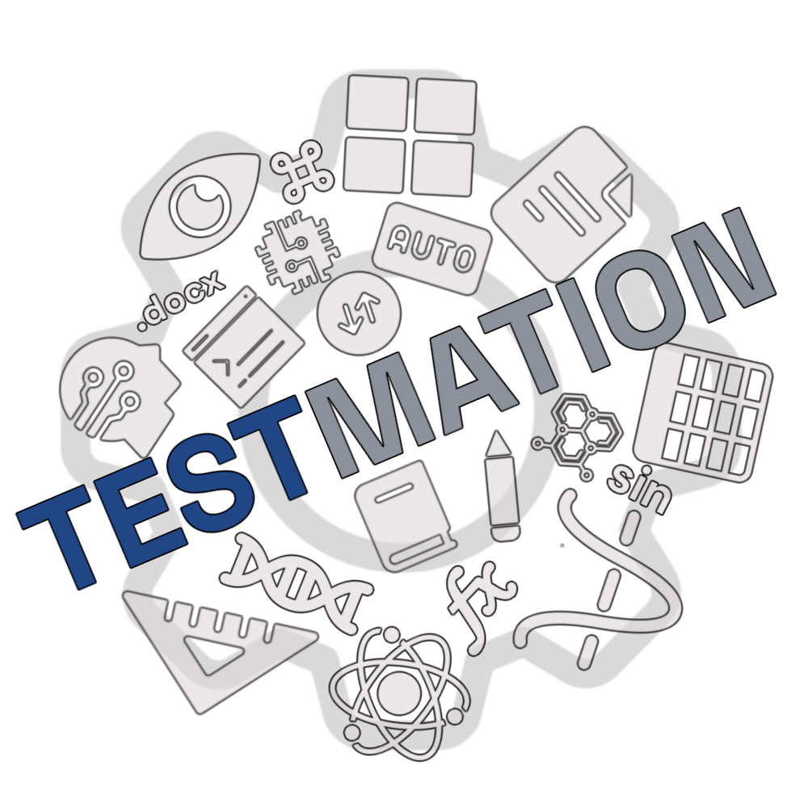
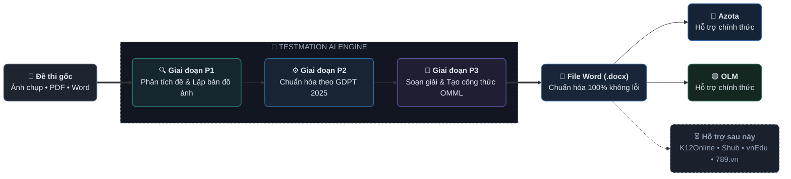

<p align="center">
  <picture>
    <source media="(prefers-color-scheme: dark)" srcset="img/TestMation_Dark.png">
    <source media="(prefers-color-scheme: light)" srcset="img/TestMation_Light.png">
    
  </picture>
</p>

<h1 align="center">TestMation</h1>
<p align="center">
  <strong>Giải pháp Tự động hóa Biên soạn & Chuẩn hóa Đề thi bằng Trí tuệ Nhân tạo</strong><br>
  <em>Tương thích tối ưu với các nền tảng học tập trực tuyến (hỗ trợ hoàn chỉnh Azota và OLM)</em>
</p>

<p align="center">
  <a href="LICENSE"></a>
  
  <a href="https://azota.vn"></a>
  <a href="https://olm.vn"></a>
  
</p>

---

<p align="center">
  <a href="README.md"><b>Tiếng Việt</b></a> &nbsp;|&nbsp; <a href="README_EN.md"><b>English</b></a>
</p>

---

## 1. TestMation là gì?

Nếu thầy cô từng đưa đề thi lên Azota hay OLM, chắc hẳn đã quen cảnh này: ngồi gõ lại từng câu hỏi từ ảnh chụp hoặc file PDF, cắt dán hình vẽ, chỉnh lại công thức Toán - Lý - Hóa, rồi đánh dấu đáp án đúng theo cú pháp riêng của từng website. Một đề 40–50 câu có thể ngốn cả buổi.

**TestMation** giúp thầy cô làm việc này nhanh hơn rất nhiều. Chỉ cần đưa đề gốc (ảnh chụp, bản scan PDF hoặc file Word cũ) cho một trợ lý AI như ChatGPT, Claude, Gemini hay DeepSeek, kèm bộ câu lệnh mẫu của TestMation, AI sẽ trả về một **file Word (.docx) đã chuẩn hóa**, sẵn sàng tải lên nền tảng:

- **Tự nhận diện cấu trúc đề:** tách đúng câu hỏi, các phương án lựa chọn và đáp án đúng.
- **Công thức chuẩn Word:** biểu thức toán học được chuyển thành phương trình gốc của Word (OMML), hiển thị sắc nét trên mọi thiết bị và vẫn chỉnh sửa được, không bị mờ như dạng ảnh.
- **Xử lý hình minh họa:** tự cắt sơ đồ, đồ thị rồi đặt đúng vào câu hỏi tương ứng; đồng thời loại bỏ con dấu, chữ ký, viền giấy scan.
- **Có sẵn lời giải chi tiết:** mỗi câu đều có phần giải thích từng bước để đối chiếu sau khi học sinh nộp bài.
- **Tải lên là chạy:** file đầu ra đúng quy chuẩn của Azota và OLM, hạn chế tối đa lỗi nhập liệu.

TestMation gồm hai thành phần với vai trò riêng biệt:
1. **`*Mation` (Bộ câu lệnh tạo đề tự động):** ([`AzotaMation.md`](Cloud_Template/Azota/AzotaMation.md), [`OLMation.md`](Cloud_Template/OLM/OLMation.md)) — Dùng trực tiếp trên các trang web AI (ChatGPT, Claude, Gemini...), có cơ chế chia nhỏ công việc để không bị cắt giữa chừng khi tạo đề thi.
2. **`*Matic` (Chỉ làm mẫu tham khảo, không dùng để tạo đề):** ([`AzotaMatic.md`](Cloud_Template/Azota/AzotaMatic.md), [`OLMatic.md`](Cloud_Template/OLM/OLMatic.md)) — Cẩm nang cú pháp, bố cục và file Word mẫu đã kiểm thử thực tế ([`AzotaMatic.docx`](Cloud_Template/Azota/AzotaMatic.docx), [`OLMatic.docx`](Cloud_Template/OLM/OLMatic.docx)) để người dùng đối chiếu cấu trúc chuẩn, **tuyệt đối không dùng để nạp vào AI tạo đề**.

> **Về khả năng mở rộng:** dự án được thiết kế theo dạng "bộ chuyển đổi" riêng cho từng nền tảng. Hiện đã hỗ trợ đầy đủ **Azota** và **OLM**, và có thể mở rộng sang K12Online, Shub Classroom, vnEdu, 789.vn...

---

## 2. AI làm việc như thế nào?

Phần này giúp thầy cô hiểu cơ chế phía sau để dùng hiệu quả hơn.

### AI "nhìn" được đề thi
Khác với phần mềm OCR truyền thống chỉ đọc chữ và thường làm hỏng công thức, các mô hình AI đa phương thức hiện nay hiểu được cả hình ảnh. AI nhận ra đâu là hình học, đồ thị hàm số, đâu chỉ là vết ố hay nếp gấp. AI cũng dịch phân số, tích phân, ma trận, công thức hóa học... thành phương trình Word chuẩn thay vì chèn một tấm ảnh mờ.

### Chia nhỏ công việc để đề dài không bị cắt giữa chừng
Mỗi lượt trả lời của AI có giới hạn độ dài. Nếu yêu cầu AI đọc đề, giải bài, định dạng và xuất file chỉ trong một lần, đề 40–50 câu rất dễ bị ngắt quãng hoặc bị rút gọn. TestMation giải quyết bằng cách chia thành **3 giai đoạn**:

- **`P1` – Phân tích đề:** AI đọc toàn bộ tài liệu, đếm số câu, xác định các phần và ghi lại vị trí những hình cần trích xuất.
- **`P2` – Chuẩn hóa câu hỏi:** AI sắp xếp lại nội dung theo đúng cú pháp của Azota hoặc OLM và đánh dấu đáp án.
- **`P3` – Viết lời giải và xuất file:** AI soạn giải thích cho từng câu rồi tạo file `.docx` hoàn chỉnh.

Nếu đề quá dài và AI dừng giữa chừng, thầy cô chỉ cần gõ tiếp `P1.2`, `P2.2` hoặc `P3.2` để AI làm nốt phần còn lại mà không mất mạch.

### Bám sát đề gốc
AI đôi khi tự "sáng tác" khi thiếu thông tin. TestMation đặt ra các quy tắc chặt để AI giữ nguyên từng số liệu, từng biến số và thứ tự câu hỏi, không tự ý sửa đề.

---

## 3. Sơ đồ quy trình



---

## 4. Những gì thầy cô nhận được

- **Đúng cấu trúc đề thi GDPT 2025 (Bộ GD&ĐT):**
  - **Phần I:** trắc nghiệm nhiều lựa chọn (chọn 1 trong 4 phương án A, B, C, D).
  - **Phần II:** trắc nghiệm Đúng - Sai (mỗi câu có 4 ý a, b, c, d, học sinh xét Đúng/Sai từng ý).
  - **Phần III:** trả lời ngắn (học sinh tự điền số hoặc kết quả, không có phương án sẵn).
- **Công thức Word gốc (OMML):** dễ chỉnh sửa, giữ nguyên phông chữ và dấu phẩy thập phân theo chuẩn Việt Nam (ví dụ $2{,}5$).
- **Hình minh họa đặt đúng chỗ:** AI ghép ảnh với câu hỏi tương ứng và loại bỏ con dấu, chữ ký giáo viên.
- **Lời giải chi tiết đi kèm:** thuận tiện cho học sinh đối chiếu sau khi làm bài.
- **Đề dài vẫn xử lý trọn vẹn:** nhờ cơ chế chia đoạn, đề dung lượng lớn không bị gián đoạn.
- **Hai ngôn ngữ:** có đầy đủ bộ câu lệnh tiếng Việt và tiếng Anh, phù hợp cả giáo viên khoa học tự nhiên lẫn giáo viên tiếng Anh, chương trình song ngữ.

---

## 5. Cách dùng trong 3 bước

Thầy cô làm ngay trên trình duyệt, không cần cài phần mềm.

### Bước 1: Chọn bộ câu lệnh tạo đề (*Mation)
Chọn file câu lệnh tương ứng với nền tảng và ngôn ngữ mong muốn:
- **Azota:**
  - Tiếng Việt: [`AzotaMation.md`](Cloud_Template/Azota/AzotaMation.md)
  - English: [`AzotaMation_EN.md`](Cloud_Template/Azota/AzotaMation_EN.md)
- **OLM:**
  - Tiếng Việt: [`OLMation.md`](Cloud_Template/OLM/OLMation.md)
  - English: [`OLMation_EN.md`](Cloud_Template/OLM/OLMation_EN.md)

Sao chép toàn bộ nội dung file **Mation** đã chọn, rồi dán vào một cuộc trò chuyện mới với AI (ChatGPT, Claude, Gemini hoặc DeepSeek).

> [!IMPORTANT]
> **Lưu ý về các file Matic:**  
> Các tệp `AzotaMatic` ([`.md`](Cloud_Template/Azota/AzotaMatic.md) / [`.docx`](Cloud_Template/Azota/AzotaMatic.docx)) và `OLMatic` ([`.md`](Cloud_Template/OLM/OLMatic.md) / [`.docx`](Cloud_Template/OLM/OLMatic.docx)) **chỉ dùng để làm mẫu tham khảo** cấu trúc và đối chiếu kết quả thực tế, **không được dùng để nạp vào AI tạo đề**.

> [!TIP]
> **Nên dùng AI có khả năng chạy code (Code Sandbox / Python)**, chẳng hạn ChatGPT có Advanced Data Analysis, Claude có Code Sandbox hoặc các AI Coding Agent. Khi đó AI sẽ chạy script Python để tạo file `.docx` với công thức Toán Word sắc nét nhất. Nếu AI của thầy cô không có tính năng này, vẫn có thể xuất tài liệu qua Google Docs/Drive hoặc tạo văn bản chuẩn để sao chép sang Word.

### Bước 2: Gửi đề và chạy P1, P2
- Đính kèm đề thi (ảnh chụp, PDF scan hoặc Word cũ) vào khung chat.
- Gõ **`P1`**: AI phân tích cấu trúc đề, đếm số câu và lập bản đồ hình ảnh (chỉ báo cáo tổng quan, không in đề thô tránh tràn token).
- Gõ **`P2`**: AI chuẩn hóa câu hỏi, phương án và đánh dấu đáp án theo chuẩn GDPT 2025.

### Bước 3: Chạy P3 và tải file
- Gõ **`P3`**: AI viết lời giải chi tiết và tạo file Word `.docx`.
- Tải file về máy rồi nhập (import) lên Azota hoặc OLM.

*(Nếu đề dài khiến AI dừng giữa chừng, thầy cô chỉ cần gõ tiếp `P1.2`, `P2.2` hoặc `P3.2` để AI làm tiếp phần còn lại.)*

---

## 6. Hai hình thức triển khai

1. **Dành cho giáo viên và người ra đề (`Cloud_Template/`) – *Dùng được ngay*:**
   - Chạy trực tiếp trên web của ChatGPT, Claude, Gemini hoặc DeepSeek.
   - Chỉ cần gửi file và nhận kết quả, không phải cài đặt hay biết lập trình.
2. **Dành cho lập trình viên và tự động hóa hàng loạt (`AgentPlugin/`) – *Sắp ra mắt!*:**
   - Dùng với các AI Coding Agent như **Cursor, Claude Code, Antigravity**.
   - Tự quét thư mục tài liệu trên máy và chạy mã Python để xử lý nhiều đề cùng lúc.

---

## 7. Hướng mở rộng

Nhờ thiết kế dạng mô-đun, bên cạnh **Azota** và **OLM**, TestMation hướng tới hỗ trợ thêm các nền tảng giáo dục và khảo thí trực tuyến tại Việt Nam:
- **K12Online**
- **Shub Classroom**
- **vnEdu**
- **789.vn**

---

## 8. Cấu trúc thư mục dự án

```text
TestMation/
├── Cloud_Template/               # Tài nguyên cho giáo viên và người dùng AI trên web
│   ├── Azota/                    # Dành riêng cho Azota
│   │   ├── AzotaMation.md        # Bộ câu lệnh tạo đề tự động (Tiếng Việt)
│   │   ├── AzotaMation_EN.md     # Bộ câu lệnh tạo đề tự động (English)
│   │   ├── AzotaMatic.md         # [Chỉ tham khảo] Cẩm nang cú pháp & quy tắc Azota
│   │   └── AzotaMatic.docx       # [Chỉ tham khảo] File Word mẫu chuẩn hóa thực tế
│   └── OLM/                      # Dành riêng cho OLM
│       ├── OLMation.md           # Bộ câu lệnh tạo đề tự động (Tiếng Việt)
│       ├── OLMation_EN.md        # Bộ câu lệnh tạo đề tự động (English)
│       ├── OLMatic.md            # [Chỉ tham khảo] Cẩm nang cú pháp & quy tắc OLM
│       └── OLMatic.docx          # [Chỉ tham khảo] File Word mẫu chuẩn hóa thực tế
├── AgentPlugin/                  # Sắp ra mắt!
├── img/                          # Logo và hình ảnh đồ họa
├── tutorial/                     # Tài liệu và video hướng dẫn thực hành
│   ├── img/                      # Ảnh chụp màn hình từng bước
│   └── video/                    # Video minh họa thao tác
├── LICENSE                       # Giấy phép mã nguồn mở MIT
├── README.md                     # Hướng dẫn tiếng Việt (bản mặc định)
└── README_EN.md                  # Detailed English Documentation
```
