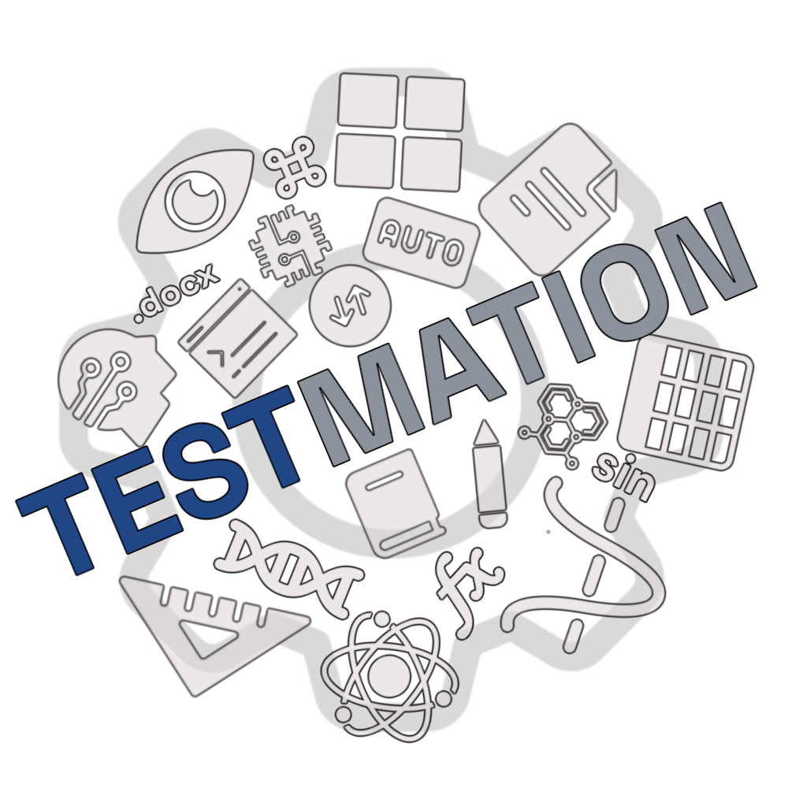

<p align="center">
  <picture>
    <source media="(prefers-color-scheme: dark)" srcset="img/TestMation_Dark.png">
    <source media="(prefers-color-scheme: light)" srcset="img/TestMation_Light.png">
    
  </picture>
</p>

<h1 align="center">TestMation</h1>
<p align="center">
  <strong>Automated Exam Formatting & Standardization Powered by AI</strong><br>
  <em>Optimized for online assessment platforms (fully supporting Azota and OLM)</em>
</p>

<p align="center">
  <a href="LICENSE"></a>
  
  <a href="https://azota.vn"></a>
  <a href="https://olm.vn"></a>
  
</p>

---

<p align="center">
  <a href="README.md"><b>Tiếng Việt</b></a> &nbsp;|&nbsp; <a href="README_EN.md"><b>English</b></a>
</p>

---

## Illustrated Step-by-Step Guides (Vietnamese)
Screenshot guides with the click targets boxed in red, split into **Test** and **Practice** branches:
- **Azota:** [`HuongDan_Azota.md`](tutorial/HuongDan_Azota.md) · [PDF](tutorial/HuongDan_Azota.pdf)
- **OLM:** [`HuongDan_OLM.md`](tutorial/HuongDan_OLM.md) · [PDF](tutorial/HuongDan_OLM.pdf)

---

## 1. What is TestMation?

If you have ever uploaded exams to Azota or OLM, you are likely familiar with the tedious routine: manually retyping questions from phone photos or PDF scans, cropping diagrams, reformatting math, physics, or chemistry equations, and tagging answer keys to match platform-specific formatting rules. A single 40–50 question test can easily consume hours.

**TestMation** makes this process vastly faster. By providing your source test (photo, scanned PDF, or legacy Word document) to a modern AI assistant (such as ChatGPT, Claude, Gemini, or DeepSeek) alongside TestMation's specialized prompt templates, the AI produces a **standardized Word (.docx) file**, ready for immediate upload:

- **Automatic structure parsing:** accurately isolates questions, multiple-choice options, and correct answers.
- **Native Word equations:** translates formulas into native Word equation objects (OMML)—crisp on every device and fully editable, rather than blurry raster screenshots.
- **Diagram and image mapping:** automatically crops geometric figures and charts, inserting them into their corresponding questions while filtering out unwanted stamps, signatures, and scan borders.
- **Step-by-step explanations included:** generates clear explanatory solutions for each question to support post-exam student review.
- **Upload without syntax errors:** output documents adhere strictly to Azota and OLM platform standards, minimizing import issues.

TestMation consists of two core components with distinct roles:
1. **`*Mation` (Prompt System for Exam Generation):** ([`AzotaMation.md`](Cloud_Template/Azota/AzotaMation.md), [`OLMation.md`](Cloud_Template/OLM/OLMation.md)) — The official prompt templates fed into web AI chats (ChatGPT, Claude, Gemini...), featuring a staged workflow to prevent output truncation when generating exams.
2. **`*Matic` (Reference Samples Only — Do Not Use to Generate Exams):** ([`AzotaMatic.md`](Cloud_Template/Azota/AzotaMatic.md), [`OLMatic.md`](Cloud_Template/OLM/OLMatic.md)) — Platform syntax rulebooks and sample Word documents ([`AzotaMatic.docx`](Cloud_Template/Azota/AzotaMatic.docx), [`OLMatic.docx`](Cloud_Template/OLM/OLMatic.docx)) designed solely for inspecting standard format and syntax; **never feed Matic files into AI to generate exams**.

> **On extensibility:** TestMation uses an adapter-based architecture. Beyond complete support for **Azota** and **OLM**, it is prepared for expansion to K12Online, Shub Classroom, vnEdu, 789.vn, and more.

---

## 2. How Does the AI Work?

Understanding these mechanisms helps educators get the most out of TestMation.

### The AI Can "See" Exam Documents
Unlike legacy OCR tools that only extract raw characters and frequently corrupt scientific formulas, modern multimodal AI models comprehend visual layouts. The AI distinguishes geometry diagrams and graphs from page folds or background noise. It converts fractions, integrals, matrices, and chemical formulas into native Word equation objects instead of inserting pixelated images.

### Staging the Workflow to Prevent Mid-Way Truncation
Every AI model enforces an output length limit per message. Asking the AI to parse, solve, format, and generate a Word document for 40–50 questions all at once frequently causes cut-offs or skipped questions. TestMation resolves this by splitting the task into **3 stages**:

- **`P1` – Structural Analysis:** The AI reviews the entire document, counts questions, catalogs sections, and maps all illustrations.
- **`P2` – Content Standardization:** The AI structures questions and options to match Azota or OLM syntax and tags correct answers.
- **`P3` – Solutions & Export:** The AI drafts detailed explanations, triggers Auto-QA to purge raw syntax, and compiles the final `.docx` document.
- **`QA` – Quality Assurance:** The AI conducts a full checklist audit, eradicating 100% raw syntax (`#, ##, <b>, <u>, <i>...`) into standard OpenXML/OMML and exporting clean files.

If an extensive exam reaches the AI's generation limit, simply type `P1.2`, `P2.2`, or `P3.2` to prompt the AI to finish the remaining section seamlessly.

### Strictly Faithful to the Original Exam
Generative AI can sometimes hallucinate when unconstrained. TestMation establishes strict rules requiring the AI to preserve all numbers, variables, and question indexing exactly as they appear in the original material.

---

## 3. Workflow Architecture

```mermaid
flowchart LR
    %% 1. SOURCE INPUT
    IN("📄 <b>Source Exam</b><br>Photos • Scanned PDF • Word"):::cInput

    %% 2. AI ENGINE PIPELINE
    subgraph ENGINE ["🤖 TESTMATION AI ENGINE"]
        direction LR
        P1("🔍 <b>Stage P1</b><br>Structure Analysis & Image Map"):::cP1
        --> P2("⚙️ <b>Stage P2</b><br>GDPT 2025 Standardization"):::cP2
        --> P3("📝 <b>Stage P3</b><br>Solutions & Native Word OMML"):::cP3
        --> QA("🛡️ <b>Stage QA</b><br>QA Audit & Syntax Eradication"):::cQA
    end

    %% 3. OUTPUT WORD FILE
    DOC("📘 <b>Word File (.docx)</b><br>100% Standardized & Error-Free"):::cDoc

    %% 4. ASSESSMENT PLATFORMS (OFFICIAL & FUTURE)
    AZOTA("🔷 <b>Azota</b><br>Officially Supported"):::cAzota
    OLM("🟢 <b>OLM</b><br>Officially Supported"):::cOlm
    NEXT("⏳ <b>Future Extensibility</b><br>K12Online • Shub • vnEdu • 789.vn"):::cNext

    %% FLOW CONNECTIONS
    IN ==> P1
    QA ==> DOC
    DOC --> AZOTA
    DOC --> OLM
    DOC -.-> NEXT

    %% STYLING DEFINITIONS (ROUNDED & MUTED GENTLE TONES)
    classDef cInput fill:#1e2430,stroke:#475569,stroke-width:1.5px,color:#e2e8f0,rx:8px,ry:8px;
    classDef cP1 fill:#16262e,stroke:#2e7d77,stroke-width:1.5px,color:#e2e8f0,rx:8px,ry:8px;
    classDef cP2 fill:#182333,stroke:#336b9e,stroke-width:1.5px,color:#e2e8f0,rx:8px,ry:8px;
    classDef cQA fill:#231a30,stroke:#7c3aed,stroke-width:1.5px,color:#e2e8f0,rx:8px,ry:8px;
    classDef cP3 fill:#1f1e33,stroke:#5e549e,stroke-width:1.5px,color:#e2e8f0,rx:8px,ry:8px;
    classDef cDoc fill:#192538,stroke:#3b679e,stroke-width:1.5px,color:#e2e8f0,rx:8px,ry:8px;
    classDef cAzota fill:#152336,stroke:#2b5e9e,stroke-width:1.5px,color:#e2e8f0,rx:8px,ry:8px;
    classDef cOlm fill:#142721,stroke:#28705a,stroke-width:1.5px,color:#e2e8f0,rx:8px,ry:8px;
    classDef cNext fill:#1a202c,stroke:#475569,stroke-width:1.5px,stroke-dasharray: 4 4,color:#94a3b8,rx:8px,ry:8px;
    style ENGINE fill:#111620,stroke:#334155,stroke-width:1px,stroke-dasharray: 4 4,color:#94a3b8;
```



---

## 4. Key Benefits for Educators

- **Compliant with the GDPT 2025 Exam Structure (Vietnam Ministry of Education):**
  - **Part I:** Multiple-choice single option (choose 1 out of 4 options A, B, C, D).
  - **Part II:** True / False multi-statement evaluation (each question consists of 4 statements a, b, c, d evaluated as True or False).
  - **Part III:** Short-answer questions (students input exact numeric or fractional values).
- **Native Word Equations (OMML):** Easily editable, preserving standard font styling and decimal conventions ($2{,}5$).
- **Clean Diagram Placement:** Connects diagrams accurately to their questions while removing extraneous stamps and teacher signatures.
- **Detailed Step-by-Step Solutions:** Facilitates immediate student review and feedback.
- **Seamless Handling of Long Exams:** The continuation mechanism prevents long tests from stalling or losing context.
- **Bilingual Availability:** Complete prompt sets in both Vietnamese and English, supporting STEM, English language, and bilingual educators alike.

---

## 5. How to Use in 3 Steps

Use directly in your browser without local software installation.

### Step 1: Select Your Exam Generation Prompt (*Mation)
Choose the configuration file corresponding to your target platform and preferred language:
- **Azota:**
  - Vietnamese: [`AzotaMation.md`](Cloud_Template/Azota/AzotaMation.md)
  - English: [`AzotaMation_EN.md`](Cloud_Template/Azota/AzotaMation_EN.md)
- **OLM:**
  - Vietnamese: [`OLMation.md`](Cloud_Template/OLM/OLMation.md)
  - English: [`OLMation_EN.md`](Cloud_Template/OLM/OLMation_EN.md)

Copy the full text of the selected **Mation** template, then paste it into a fresh chat session with your AI platform (ChatGPT, Claude, Gemini, or DeepSeek).

> [!IMPORTANT]
> **Important Note Regarding Matic Files:**  
> The `AzotaMatic` ([`.md`](Cloud_Template/Azota/AzotaMatic.md) / [`.docx`](Cloud_Template/Azota/AzotaMatic.docx)) and `OLMatic` ([`.md`](Cloud_Template/OLM/OLMatic.md) / [`.docx`](Cloud_Template/OLM/OLMatic.docx)) files **are strictly for reference and inspection**, and **must not be used as prompts or fed into AI to generate exams**.

> [!TIP]
> **Using an AI with code execution capabilities (Code Sandbox / Python)**—such as ChatGPT Advanced Data Analysis, Claude with Code Sandbox, or AI Coding Agents—is highly recommended. The AI runs a Python script to package the `.docx` document with pristine Word equations. If your AI lacks this feature, you can still export documents via Google Docs/Drive or copy compliant formatted text.

### Step 2: Upload Exam & Run P1, P2
- Attach your source exam file (photo, scanned PDF, or Word document) in the chat window.
- Send **`P1`**: The AI analyzes document structure, counts questions, and maps diagrams (summary report only, avoiding raw text to prevent token overflow).
- Send **`P2`**: The AI standardizes questions, choices, and answer markers according to GDPT 2025 guidelines.

### Step 3: Run P3 & Download the Word File
- Send **`P3`**: The AI drafts detailed explanations and compiles the `.docx` document.
- Download the generated file and import it directly into Azota or OLM.

*(If an extensive exam causes the AI to pause, simply type `P1.2`, `P2.2`, or `P3.2` to prompt the AI to resume seamlessly).*

---

## 6. Two Deployment Paths

1. **For Teachers and Educators (`Cloud_Template/`) – *Ready to Use*:**
   - Runs directly on the web interfaces of ChatGPT, Claude, Gemini, or DeepSeek.
   - Simply upload files and receive results without any setup or programming knowledge.
2. **For Developers and Batch Automation (`AgentPlugin/`) – *Coming Soon!*:**
   - Designed for AI Coding Agents such as **Cursor, Claude Code, Antigravity**.
   - Scans local repository folders and runs Python scripts to process multiple exams automatically.

---

## 7. Future Extensibility

Thanks to its modular adapter architecture, beyond full support for **Azota** and **OLM**, TestMation is oriented toward supporting popular Vietnamese online testing and learning platforms:
- **K12Online**
- **Shub Classroom**
- **vnEdu**
- **789.vn**

---

## 8. Repository Structure

```text
TestMation/
├── Cloud_Template/               # Primary templates for educators & web AI users
│   ├── Azota/                    # Dedicated resources for Azota
│   │   ├── AzotaMation.md        # Automated exam generation system (Vietnamese)
│   │   ├── AzotaMation_EN.md     # Automated exam generation system (English)
│   │   ├── AzotaMatic.md         # [Reference Only] Syntax rulebook & layout specification
│   │   └── AzotaMatic.docx       # [Reference Only] Sample Word file tested on Azota
│   └── OLM/                      # Dedicated resources for OLM
│       ├── OLMation.md           # Automated exam generation system (Vietnamese)
│       ├── OLMation_EN.md        # Automated exam generation system (English)
│       ├── OLMatic.md            # [Reference Only] Syntax rulebook & layout specification
│       └── OLMatic.docx          # [Reference Only] Sample Word file tested on OLM
├── evals/                        # Benchmark & Evaluation Suite (12 subjects GDPT 2025)
│   ├── .docx/                    # Standardized Word documents (Merged Exam + Answer Keys)
│   └── .pdf/                     # Original PDF sample exams released by MOET Vietnam
├── img/                          # Logos and graphical assets
├── tutorial/                     # Step-by-step guides
│   ├── HuongDan_Azota.*          # Azota guide (.md, .pdf)
│   ├── HuongDan_OLM.*            # OLM guide (.md, .pdf)
│   └── img/                      # Guide screenshots
│       ├── Azota/                # Raw Azota screenshots
│       │   └── annotated/        # Screenshots with red boxes
│       └── OLM/                  # Raw OLM screenshots
│           └── annotated/        # Screenshots with red boxes
├── LICENSE                       # Apache 2.0 Open Source License
├── README.md                     # Vietnamese Documentation (Default)
└── README_EN.md                  # Detailed English Documentation
```
