# Hướng dẫn sử dụng TestMation cho Azota

> **Quy trình chuyển đổi đề thi bằng AI & Xuất bản trực tuyến trên Azota**

## Giới thiệu tổng quan

Tài liệu này hướng dẫn chi tiết quy trình biến một đề thi có sẵn (ảnh chụp đề, file PDF hoặc tài liệu Word thô) thành đề thi trực tuyến hoàn chỉnh trên nền tảng Azota với sự trợ giúp của AI (Trí tuệ nhân tạo).

Toàn bộ quy trình diễn ra trực tiếp trên trình duyệt web, không cần cài đặt phần mềm phức tạp. Bạn có thể sử dụng Google Gemini, ChatGPT, Claude hoặc DeepSeek với các câu lệnh mẫu chuẩn hóa của TestMation.

Hệ thống hướng dẫn gồm 2 giai đoạn: **Phần thao tác chung** (chuẩn bị câu lệnh, biên soạn đề AI, nạp lên Azota) và **Phần phân nhánh** (lựa chọn giữa chế độ **Thi/Kiểm tra tính điểm** hoặc **Luyện tập trả lời từng câu**).

### Quy ước ký hiệu thao tác

- **Khung viền đỏ**: Vị trí nút bấm, menu hoặc trường nhập liệu cần tương tác.
- **Số trong vòng đỏ (1), (2), (3)**: Thứ tự các bước thao tác tuần tự cần bấm.
- **Hộp Mẹo**: Cách làm nhanh hơn và cho kết quả AI tốt hơn.
- **Hộp Lưu ý**: Những điểm cần kiểm tra để đề không bị sai khi đưa lên hệ thống.

> **Lưu ý quan trọng:** Chỉ gửi file `AzotaMation.md` cho AI. Các file có tiền tố `AzotaMatic` chỉ là file mẫu để bạn so sánh kết quả, **không** gửi cho AI.

### Cần chuẩn bị

- Tài khoản của một AI: Google Gemini, ChatGPT, Claude hoặc DeepSeek.
- Tài khoản giáo viên trên Azota.
- Microsoft Word (hoặc phần mềm mở được file .docx) để kiểm tra file trước khi đưa lên.
- File đề gốc: ảnh chụp, PDF hoặc Word.

> **Mẹo:** Hình minh họa trong tài liệu chụp trên Google Gemini. Với AI khác, vị trí nút đính kèm và nút tải file có thể khác, nhưng các lệnh `P1`, `P2`, `P3` giữ nguyên.

## Mục lục

- [A. Tải bộ câu lệnh về máy](#a-tải-bộ-câu-lệnh-về-máy)
- [B. Nhờ AI soạn đề thành file Word](#b-nhờ-ai-soạn-đề-thành-file-word)
- [C. Đưa đề lên Azota](#c-đưa-đề-lên-azota)
- [Nhánh 1: Chế độ Thi / Kiểm tra](#nhánh-1-chế-độ-thi--kiểm-tra)
- [Nhánh 2: Chế độ Luyện tập](#nhánh-2-chế-độ-luyện-tập)
- [Mẹo hay & Quy tắc sử dụng](#mẹo-hay--quy-tắc-sử-dụng)

## A. Tải bộ câu lệnh về máy

### [ BƯỚC 01 ]  Mở trang TestMation trên GitHub

Mở trang TestMation trên GitHub. Tại cột thông tin bên phải, tìm mục **Releases** và bấm chọn **TestMation (Latest)** để vào trang phát hành mới nhất.

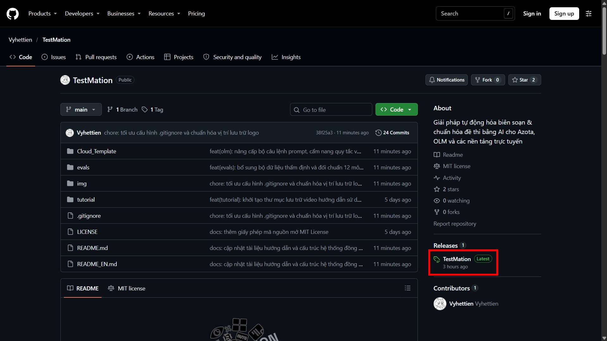

*Hình 01: Mở trang TestMation trên GitHub*

### [ BƯỚC 02 ]  Tải file AzotaMation.md

Trong danh sách tệp đính kèm (Assets), bấm chọn **AzotaMation.md** để tải về máy tính. Đây là bộ câu lệnh chuẩn tiếng Việt. Nếu bạn cần bản tiếng Anh, chọn tải `AzotaMation_EN.md`.

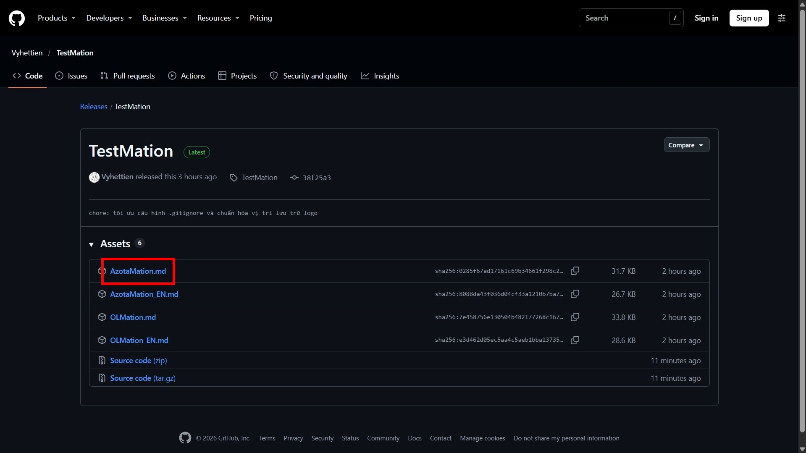

*Hình 02: Tải file AzotaMation.md*

## B. Nhờ AI soạn đề thành file Word

### [ BƯỚC 03 ]  Đưa bộ câu lệnh cho AI

Mở cuộc trò chuyện mới với AI. Bấm **(1) biểu tượng dấu +** để đính kèm tệp, chọn **(2) file AzotaMation.md** vừa tải về. Sau đó gửi **(3) câu thông báo ngắn**, ví dụ: “Nạp cấu hình mẫu này giúp tôi”. AI sẽ phản hồi xác nhận đã sẵn sàng.

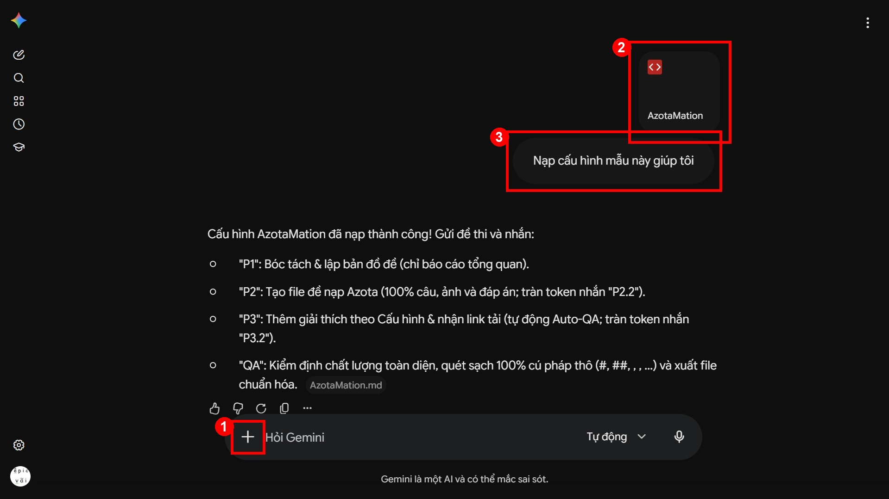

*Hình 03: Đưa bộ câu lệnh cho AI*

### [ BƯỚC 04 ]  Gửi đề và gõ P1

Đính kèm **(1) file đề thi cần xử lý** (ảnh chụp hoặc PDF/Word), sau đó gõ lệnh **(2) `P1`** và nhấn gửi. AI sẽ quét toàn bộ đề và báo cáo tổng quan: số lượng câu hỏi, cấu trúc từng phần. Hãy kiểm tra xem số câu có khớp với đề gốc hay không.

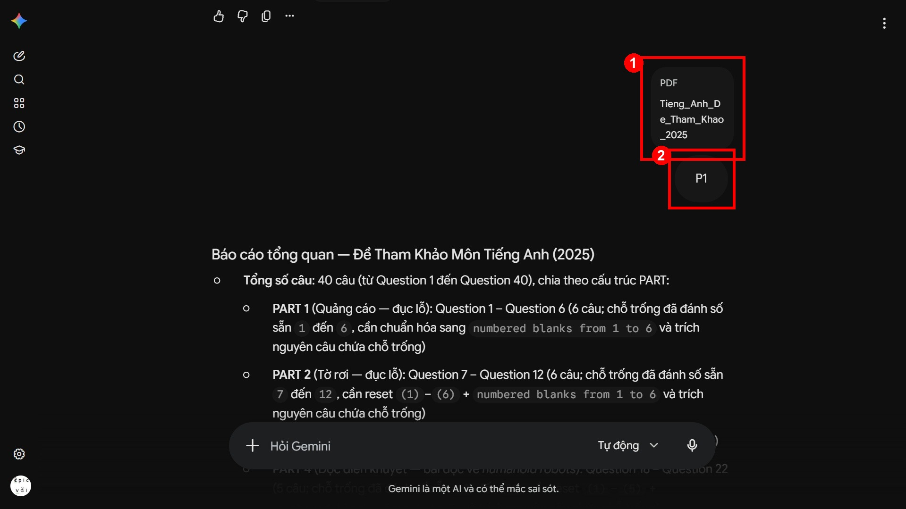

*Hình 04: Gửi đề và gõ P1*

### [ BƯỚC 05 ]  Gõ P2 để AI soạn đề

Gõ câu lệnh **`P2`** vào ô chat và gửi. AI sẽ tự động định dạng và soạn thảo lại toàn bộ câu hỏi, các phương án lựa chọn và đánh dấu đáp án đúng theo đúng cú pháp tiêu chuẩn của Azota.

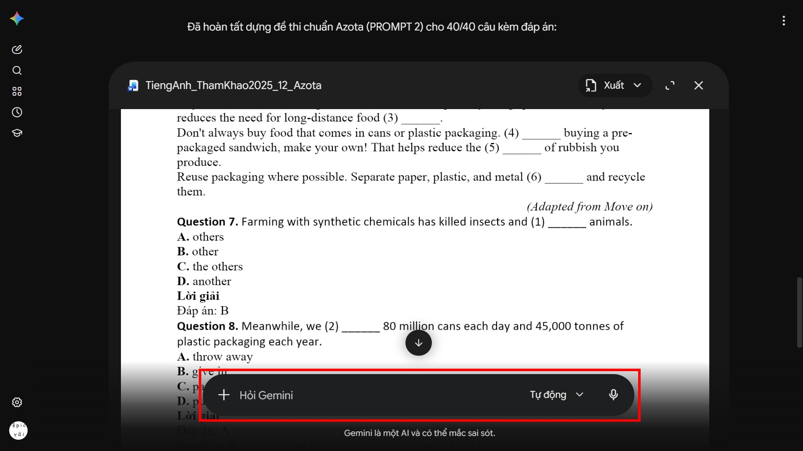

*Hình 05: Gõ P2 để AI soạn đề*

### [ BƯỚC 06 ]  Gõ P3 và tải file Word

Gõ tiếp câu lệnh **`P3`**. AI sẽ viết lời giải chi tiết cho từng câu hỏi và chạy kiểm tra tính nhất quán (QA). Khi khung file xuất hiện, bấm nút **Xuất** để tải file Word (.docx) về máy. Trên AI khác, nút này có thể là một đường link tải file.

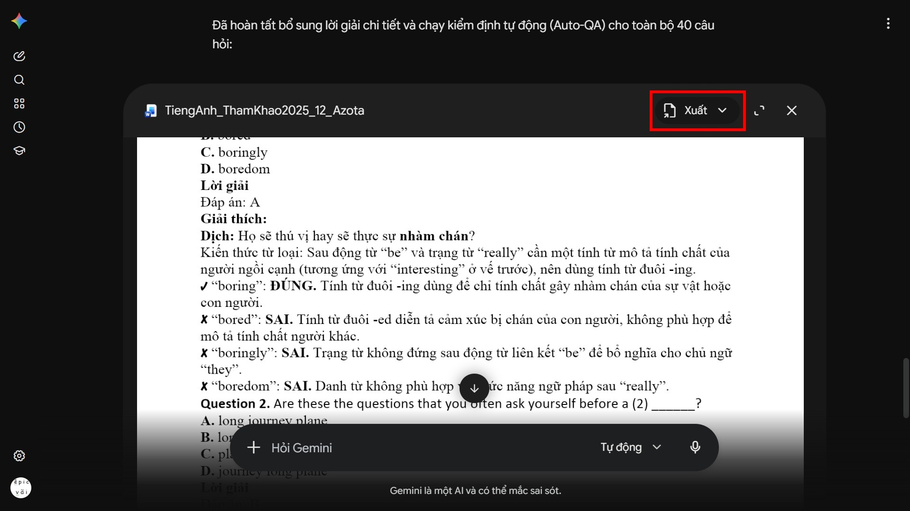

*Hình 06: Gõ P3 và tải file Word*

> **Lưu ý:** Nếu đề gốc không kèm đáp án, AI sẽ tự chọn đáp án và tự viết lời giải, nên có thể sai. Hãy tự soát lại đáp án từng câu, không chỉ soát định dạng.

> **Mẹo:** Nếu AI chỉ trả về văn bản mà không có file Word, hãy yêu cầu: “Xuất kết quả thành file .docx”. Nếu AI đó không tạo được file, hãy chuyển sang AI khác có tính năng tạo file.

> **Mẹo:** Để AI rà soát lỗi lần cuối, hãy gõ lệnh **`QA`**. AI sẽ dọn các ký hiệu thừa như dấu thăng (#, ##) trong tài liệu.

### [ BƯỚC 07 ]  Mở file Word để xem lại (ví dụ môn Tiếng Anh)

Mở file vừa tải về bằng Microsoft Word. Nếu Word hiển thị thanh màu vàng, bấm **Enable Editing** để bật chỉnh sửa. Cột danh mục bên trái (Navigation) liệt kê đầy đủ từng phần và từng câu. Kiểm tra xem mỗi câu đã có đủ đáp án đúng và phần giải thích chi tiết chưa.

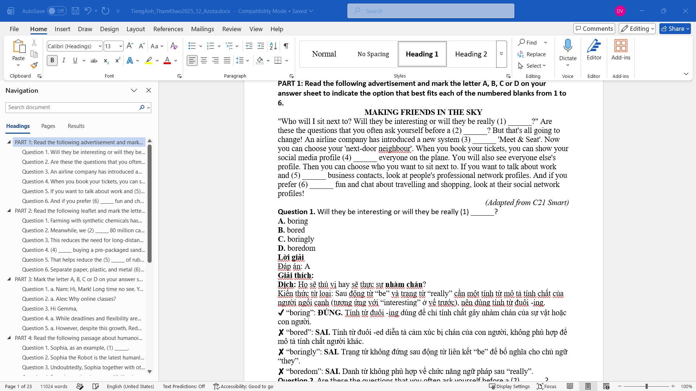

*Hình 07: Mở file Word để xem lại (ví dụ môn Tiếng Anh)*

### [ BƯỚC 08 ]  Mở file Word để xem lại (ví dụ môn Toán)

Đối với môn Toán và các môn khoa học tự nhiên, hãy quan sát các công thức toán học có hiển thị chuẩn xác, rõ nét không và cấu trúc đề có đủ 3 phần chuẩn GDPT 2025 không. Nếu đề có hình vẽ hoặc bảng biểu, kiểm tra xem hình có đủ và nằm đúng câu không.

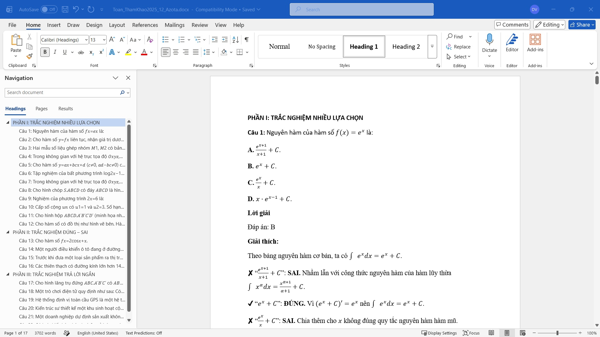

*Hình 08: Mở file Word để xem lại (ví dụ môn Toán)*

## C. Đưa đề lên Azota

### [ BƯỚC 09 ]  Vào mục Đề thi

Đăng nhập vào Azota bằng tài khoản giáo viên của bạn. Tại màn hình bảng điều khiển chính (Dashboard), bấm vào ô chức năng **Đề thi**.

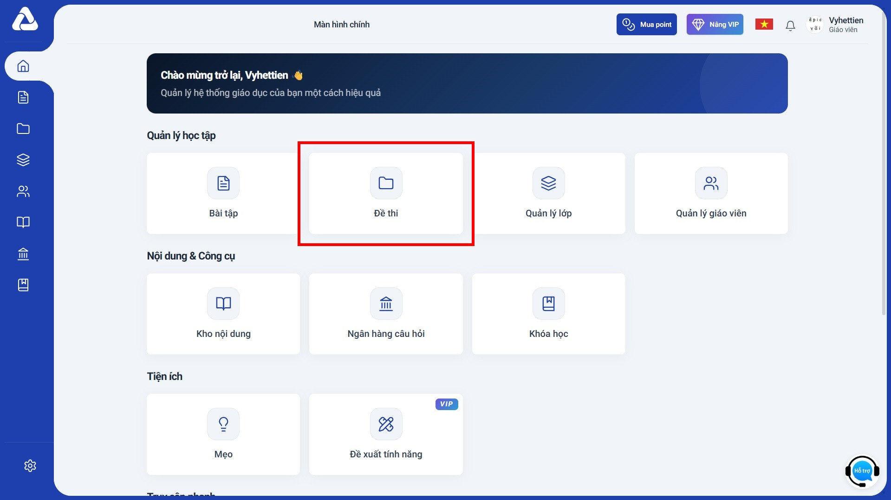

*Hình 09: Vào mục Đề thi*

### [ BƯỚC 10 ]  Bấm Tạo đề thi

Tại góc trên giao diện quản lý đề, bấm vào nút màu xanh lá cây **+ Tạo đề thi**.

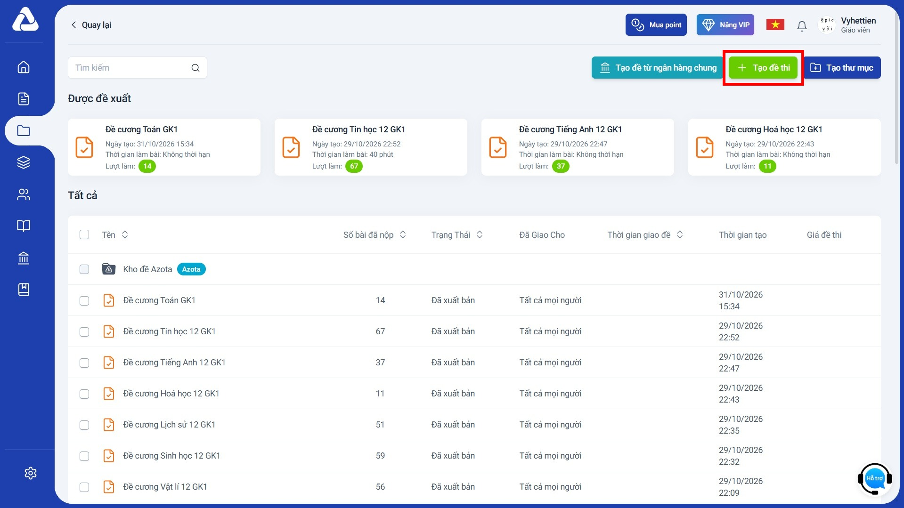

*Hình 10: Bấm Tạo đề thi*

### [ BƯỚC 11 ]  Chọn file Word

Bấm vào khung **Chọn File hoặc kéo thả File vào đây**, sau đó chọn file Word chuẩn đã được tải về từ AI ở Phần B.

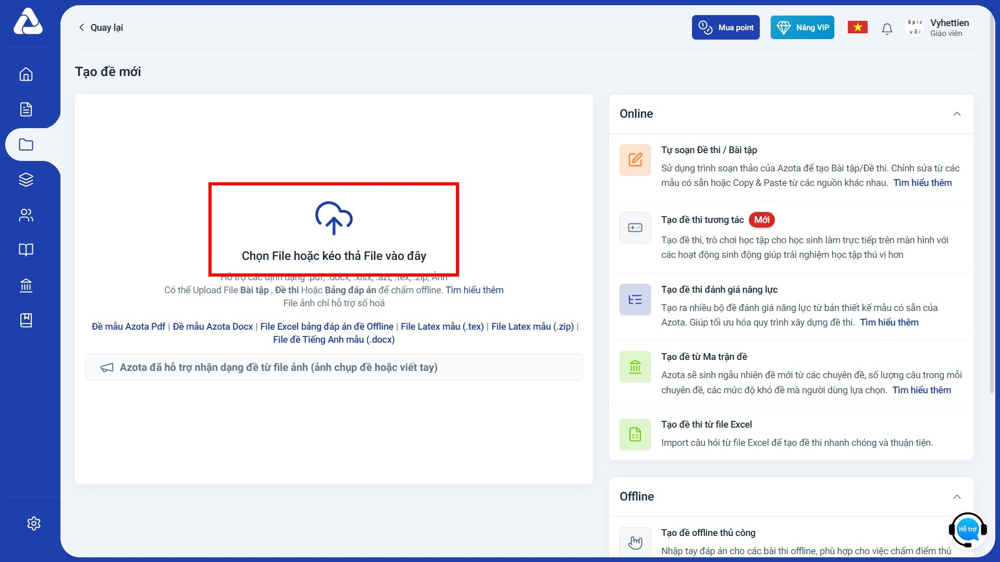

*Hình 11: Chọn file Word*

### [ BƯỚC 12 ]  Xem lại đề trên Azota

Hệ thống Azota sẽ tự động nhận diện và hiển thị đề thi. Lướt kiểm tra nhanh vài câu hỏi: nội dung câu hỏi, đáp án đúng (có tích xanh) và phần lời giải tương ứng.

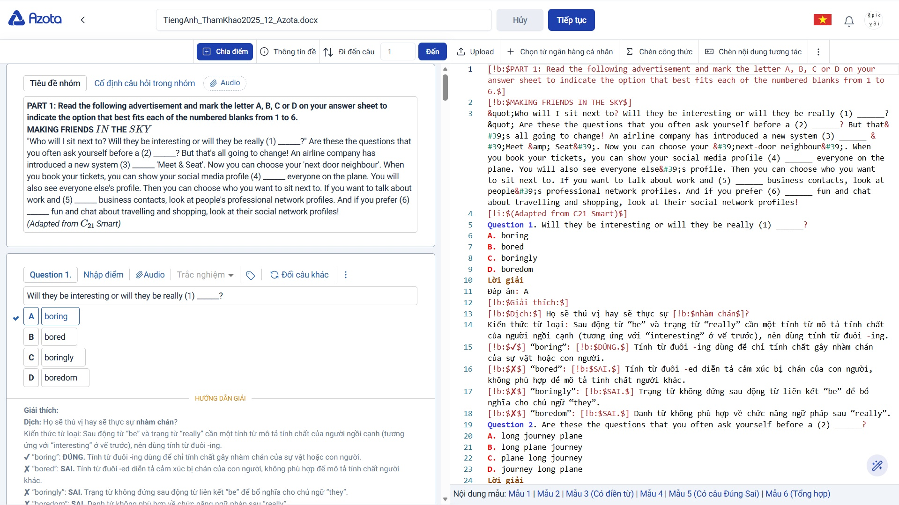

*Hình 12: Xem lại đề trên Azota*

### [ BƯỚC 13 ]  Bấm Tiếp tục

Khi kiểm tra thấy các câu hỏi đã được Azota nhận diện chính xác, bấm nút **Tiếp tục** ở thanh công cụ phía trên góc phải.

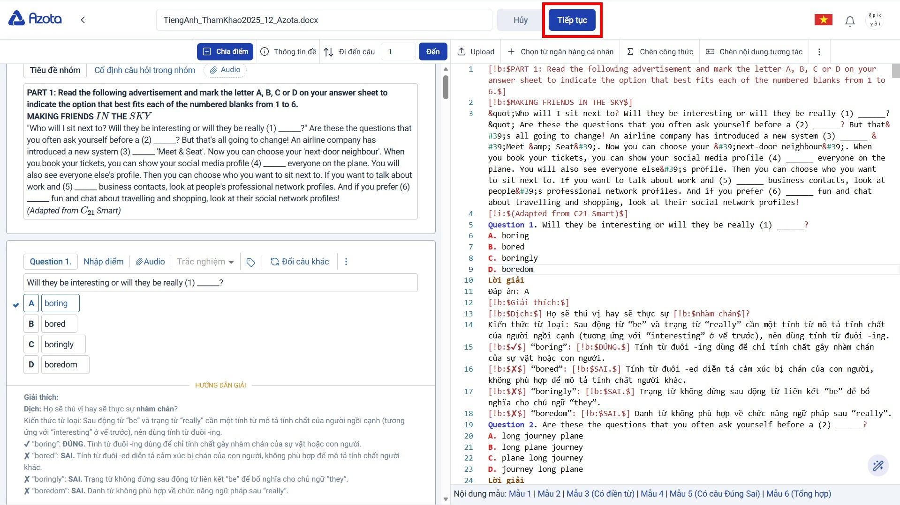

*Hình 13: Bấm Tiếp tục*

### [ BƯỚC 14 ]  Kiểm tra số câu

Hộp thoại xác nhận sẽ hiển thị tổng số câu hệ thống đã nhận diện. So khớp với số lượng câu AI đã thống kê ở bước P1. Nếu hoàn toàn khớp, bấm **Tiếp tục**. Nếu lệch, đừng bấm tiếp: mở lại file Word tìm câu bị thiếu hoặc bị gộp, sửa rồi nạp lại file; nếu AI đã dừng giữa chừng thì quay lại gõ `P2.2`.

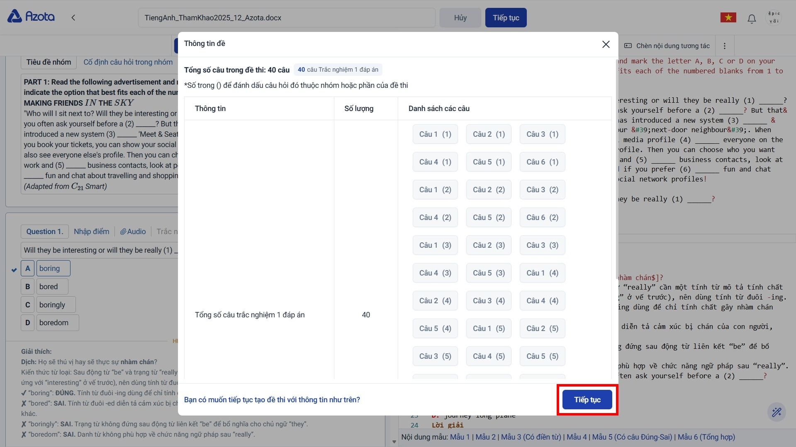

*Hình 14: Kiểm tra số câu*

### [ BƯỚC 15 ]  Điền thông tin đề

Điền các trường thông tin: **(1) Tên đề thi**, chọn **(2) Khối lớp**, **(3) Môn học** và **(4) Mục đích tạo đề**. Sau đó bấm **(5) Lưu**.

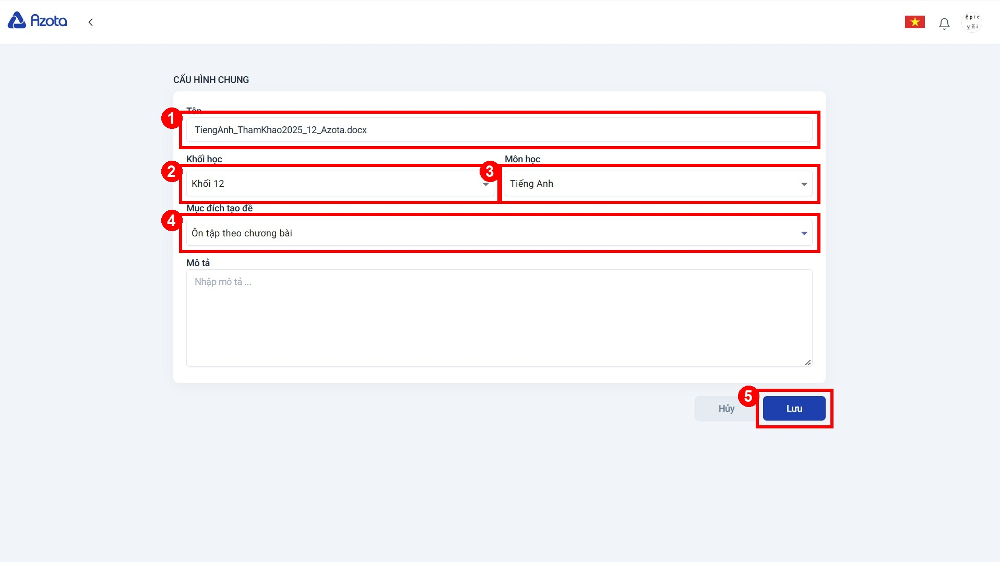

*Hình 15: Điền thông tin đề*

### [ BƯỚC 16 ]  Chọn làm bài online

Azota thông báo tạo đề thành công. Bấm chọn **Cài đặt làm bài online**. Từ bước này, bạn lựa chọn tiếp tục với Nhánh 1 hoặc Nhánh 2 bên dưới tùy theo nhu cầu tổ chức thi.

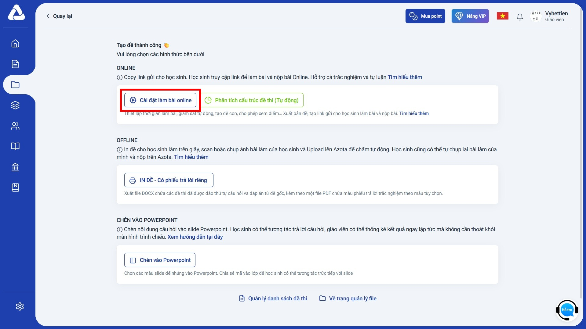

*Hình 16: Chọn làm bài online*

## Nhánh 1: Chế độ Thi / Kiểm tra

### [ BƯỚC 17 ]  Giáo viên: chọn chế độ Kiểm tra

Bấm chọn **(1) Chế độ Kiểm tra**. Chế độ này dành cho bài kiểm tra chính thức: học sinh làm toàn bộ đề và không xem được đáp án trong quá trình làm bài. Nhập **(2) thời gian làm bài (phút)** (nhập 0 nếu không giới hạn) và thiết lập **(3) phân quyền đối tượng làm bài**.

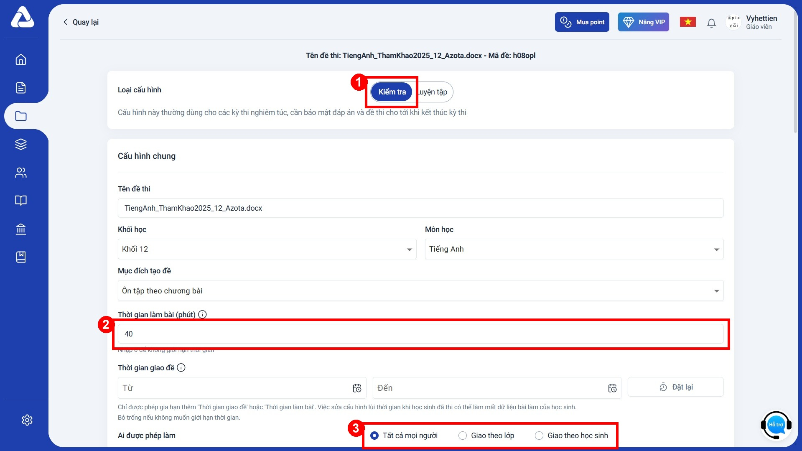

*Hình 17: Giáo viên: chọn chế độ Kiểm tra*

### [ BƯỚC 18 ]  Giáo viên: chọn thời điểm xem điểm, đáp án và xuất bản

Cuộn xuống phần cấu hình hiển thị: chọn thời điểm học sinh **(1) được xem điểm** và **(2) được xem đáp án chi tiết**. Sau đó bấm **(3) Xuất bản** để kích hoạt đề thi.

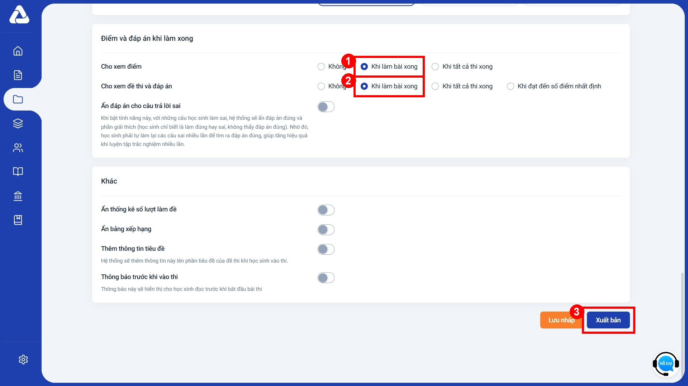

*Hình 18: Giáo viên: chọn thời điểm xem điểm, đáp án và xuất bản*

### [ BƯỚC 19 ]  Giáo viên: sao chép và gửi link cho học sinh

Bấm nút **Sao chép** để lấy đường link đề thi, sau đó gửi cho học sinh qua Zalo, Messenger hoặc cổng thông tin lớp học.

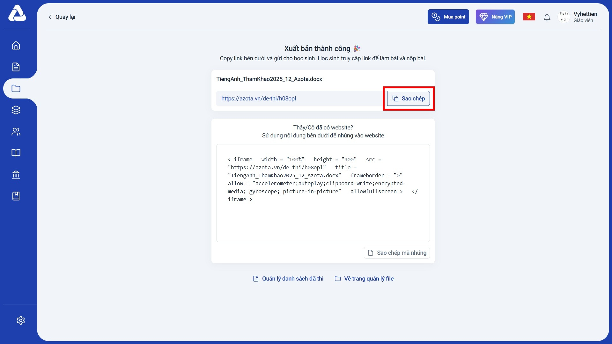

*Hình 19: Giáo viên: sao chép và gửi link cho học sinh*

> **Mẹo:** Trước khi gửi link cho học sinh, hãy tự mở link và làm thử một lượt.

### [ BƯỚC 20 ]  Học sinh: bắt đầu làm bài

Học sinh truy cập đường link được giao, đọc kỹ thông tin thời gian làm bài và số lượng câu hỏi, sau đó bấm **Bắt đầu thi**.

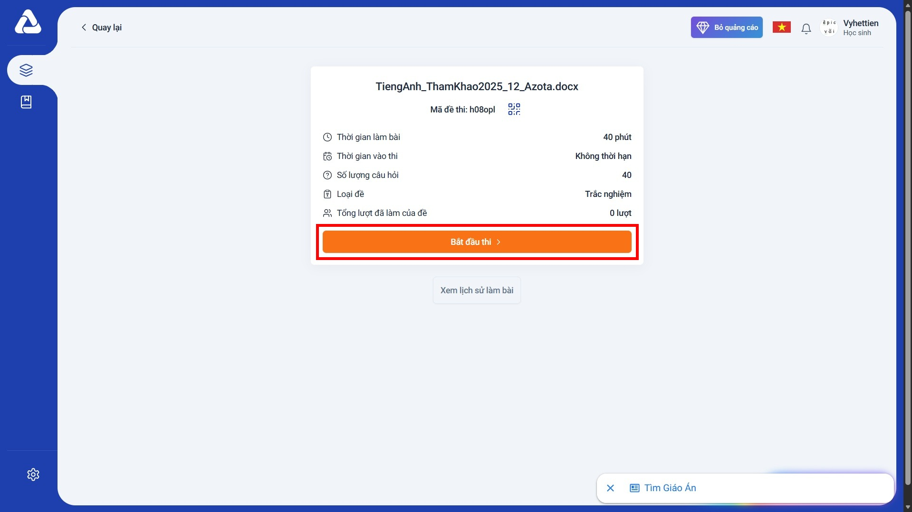

*Hình 20: Học sinh: bắt đầu làm bài*

### [ BƯỚC 21 ]  Học sinh: chế độ xem danh sách câu hỏi toàn trang

Học sinh có thể bấm **(1) nút chuyển đổi chế độ xem**, chọn **(2) Hiển thị danh sách câu hỏi**. Bảng số thứ tự bên phải cho phép bấm chuyển nhanh đến câu hỏi cần trả lời.

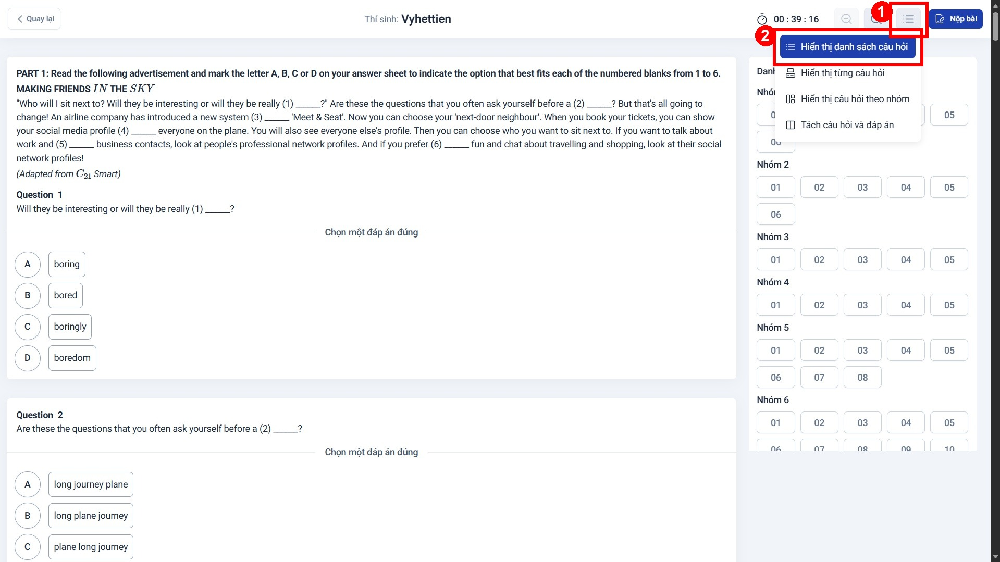

*Hình 21: Học sinh: chế độ xem danh sách câu hỏi toàn trang*

### [ BƯỚC 22 ]  Học sinh: chế độ xem câu hỏi theo nhóm

Học sinh cũng có thể bấm **(1) nút chuyển đổi chế độ xem** rồi chọn **(2) Hiển thị câu hỏi theo nhóm**: đoạn văn/ngữ liệu hiển thị ở khung bên trái, câu hỏi bên phải. Bấm **(3) Nhóm tiếp theo** để chuyển sang phần kế tiếp.

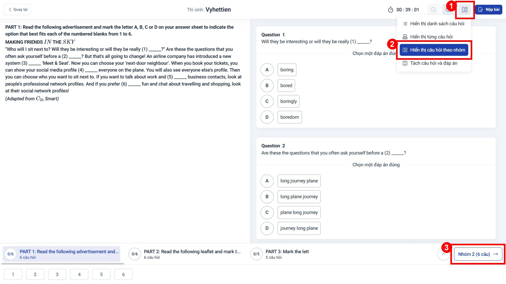

*Hình 22: Học sinh: chế độ xem câu hỏi theo nhóm*

### [ BƯỚC 23 ]  Học sinh: nộp bài và xem bảng điểm

Sau khi hoàn thành các câu hỏi, học sinh bấm **Nộp bài**. Hệ thống lập tức chấm điểm và hiển thị kết quả kèm xếp hạng. Bấm **Xem đáp án** để tra cứu bài làm nếu giáo viên cho phép.

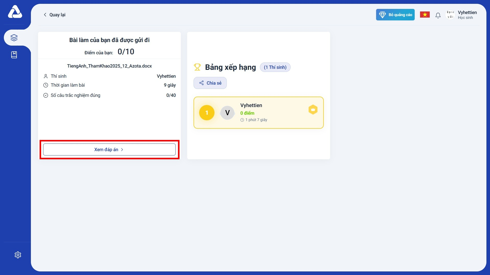

*Hình 23: Học sinh: nộp bài và xem bảng điểm*

## Nhánh 2: Chế độ Luyện tập

### [ BƯỚC 24 ]  Giáo viên: chọn chế độ Luyện tập

Bấm chọn **(1) Chế độ Luyện tập**. Ở chế độ này, học sinh làm từng câu và biết ngay kết quả đúng/sai kèm lời giải. Bạn có thể bật tùy chọn **(2) Luyện tập lại những câu làm sai** để củng cố kiến thức cho học sinh.

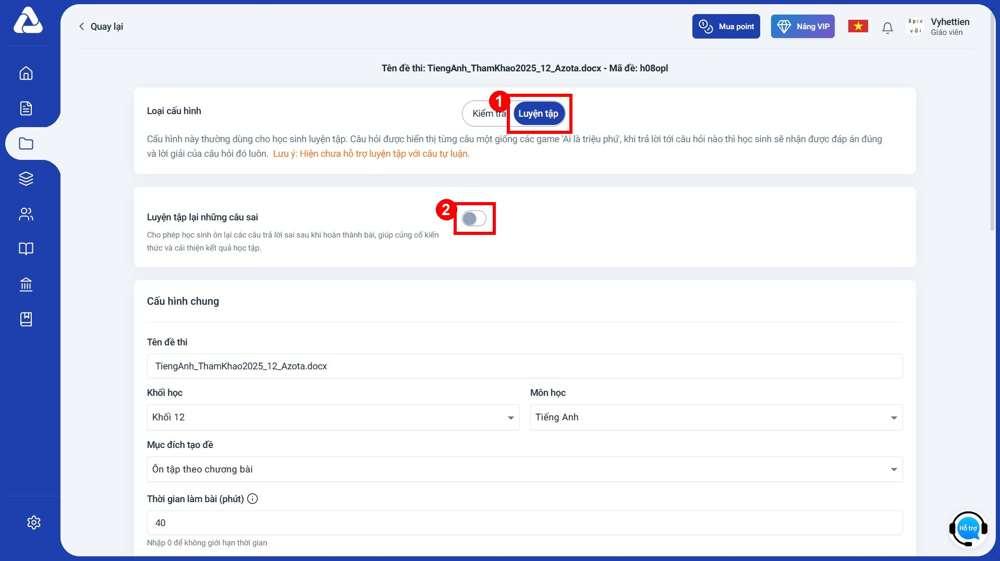

*Hình 24: Giáo viên: chọn chế độ Luyện tập*

### [ BƯỚC 25 ]  Giáo viên: xuất bản và phân phối link

Cuộn xuống dưới, bấm **Xuất bản**, sau đó bấm **Sao chép** để lấy link giao bài. Thao tác hoàn toàn tương đồng với Nhánh 1 (tham khảo hình ảnh ở Bước 18 và Bước 19). Học sinh mở link và bấm **Bắt đầu thi**.

*Hình 25: Giáo viên: xuất bản và phân phối link*

### [ BƯỚC 26 ]  Học sinh: chọn đáp án và kiểm tra ngay

Học sinh **(1) bấm chọn phương án trả lời** (hoặc nhấn phím số 1, 2, 3, 4 trên bàn phím), sau đó bấm nút **(2) Kiểm tra** (hoặc gõ phím Enter).

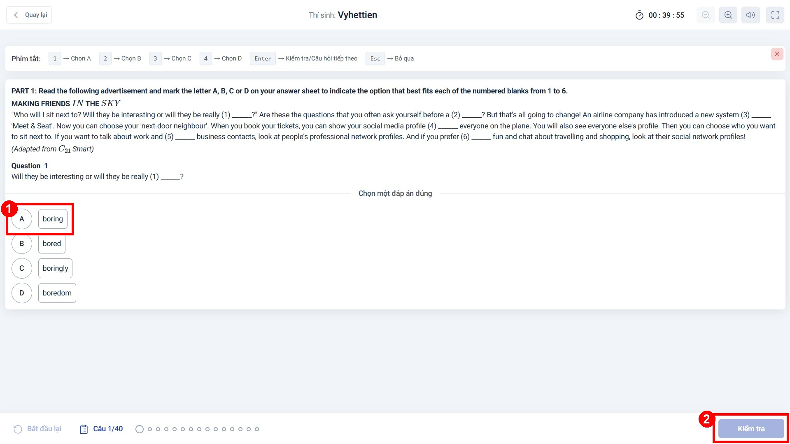

*Hình 26: Học sinh: chọn đáp án và kiểm tra ngay*

### [ BƯỚC 27 ]  Học sinh: phản hồi khi trả lời đúng

Nếu lựa chọn chính xác, hệ thống hiển thị thông báo chúc mừng “Làm tốt lắm”. Học sinh bấm nút **Câu tiếp theo** để chuyển sang câu kế tiếp.

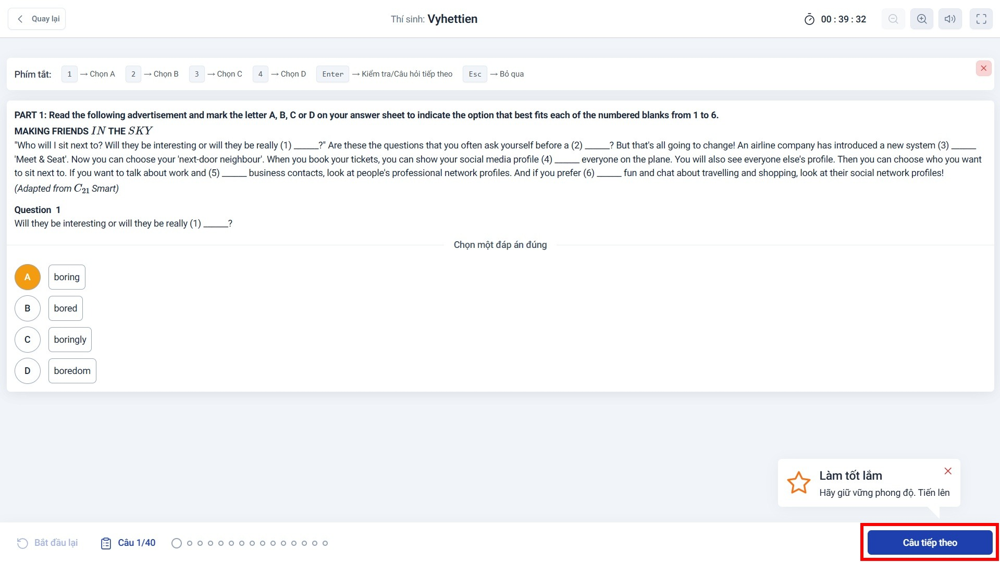

*Hình 27: Học sinh: phản hồi khi trả lời đúng*

### [ BƯỚC 28 ]  Học sinh: phản hồi khi trả lời sai và đọc lời giải

Nếu trả lời sai, khung lời giải chi tiết sẽ hiển thị ngay bên dưới để học sinh nắm rõ phương pháp giải. Học sinh có thể bấm **(1) Thử lại** để làm lại câu đó, hoặc bấm **(2) Bỏ qua** để đi tiếp.

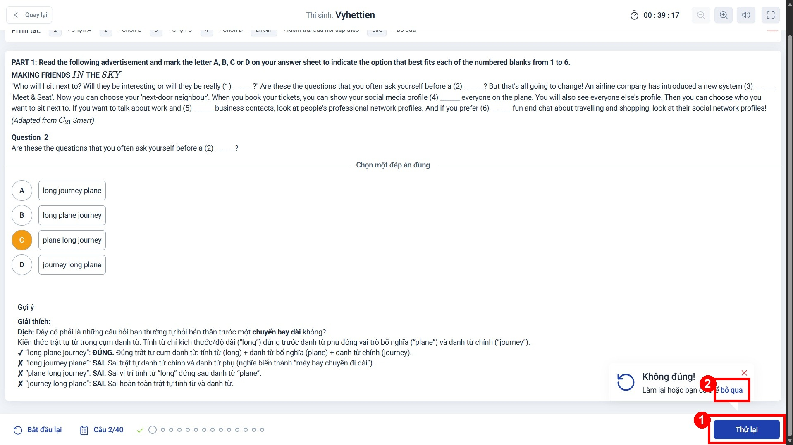

*Hình 28: Học sinh: phản hồi khi trả lời sai và đọc lời giải*

### [ BƯỚC 29 ]  Học sinh: tổng kết đáp án và lời giải chi tiết

Tại màn hình tổng kết bài luyện tập, học sinh bấm **(1) Đúng & sai** hoặc **Đề gốc** để lọc câu hỏi, và bấm **(2) Giải thích** để tra cứu lại toàn bộ lời giải chi tiết của đề thi.

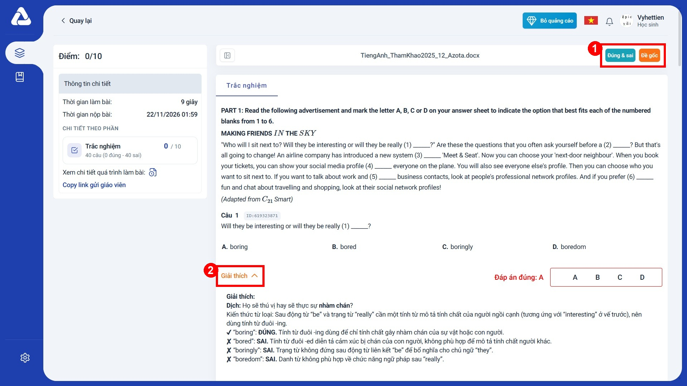

*Hình 29: Học sinh: tổng kết đáp án và lời giải chi tiết*

## Mẹo hay & Quy tắc sử dụng

### Mẹo thao tác & Tối ưu AI

- Nếu đề thi có số lượng câu lớn khiến AI dừng sinh giữa chừng, bạn chỉ cần gõ lệnh tiếp tục: `P1.2`, `P2.2` hoặc `P3.2` để AI tiếp tục hoàn thiện phần còn lại.
- Nếu AI bạn dùng có tính năng chạy code để tạo file, công thức toán trong file Word sẽ là công thức Word thật (sửa được) và sắc nét hơn.

### Kiểm tra trước khi giao

- Chỉ gửi file `AzotaMation.md` cho AI. Các file `AzotaMatic` chỉ là file mẫu để so sánh kết quả, **không** gửi cho AI.
- Trước khi xuất bản, luôn so tổng số câu AI báo ở bước P1 với số câu Azota nhận diện.
- Đáp án và lời giải do AI viết có thể sai, nhất là khi đề gốc không kèm đáp án. Hãy soát lại từng câu.
