# Hướng dẫn sử dụng TestMation cho OLM

> **Quy trình chuyển đổi đề thi bằng AI & Xuất bản trực tuyến trên OLM.vn**

## Giới thiệu tổng quan

Tài liệu này giúp bạn nhanh chóng chuyển đổi một đề thi có sẵn (ảnh chụp đề, file PDF hoặc file Word) lên hệ thống OLM (olm.vn) để tổ chức kiểm tra và luyện tập trực tuyến cho học sinh.

Mọi thao tác được thực hiện thuận tiện trên trình duyệt web, không đòi hỏi cài đặt thêm công cụ ngoài. Bạn có thể dùng Google Gemini, ChatGPT, Claude hoặc DeepSeek. Các công đoạn phức tạp nhất như gõ lại đề bài, vẽ bảng biểu và soạn lời giải chi tiết sẽ do AI thực hiện tự động qua bộ câu lệnh OLMation chuẩn hóa.

Các phần từ A đến D là quy trình thiết lập chung. Sau đó, giáo viên linh hoạt lựa chọn **Nhánh 1** (kiểm tra chấm điểm tập trung) hoặc **Nhánh 2** (luyện tập tương tác từng câu có phản hồi tức thì).

### Quy ước ký hiệu thao tác

- **Khung viền đỏ**: Vị trí nút bấm, menu hoặc trường nhập liệu cần tương tác.
- **Số trong vòng đỏ (1), (2), (3)**: Thứ tự các bước thao tác tuần tự cần bấm.
- **Hộp Mẹo**: Cách làm nhanh hơn và cho kết quả AI tốt hơn.
- **Hộp Lưu ý**: Những điểm cần kiểm tra để đề không bị sai khi đưa lên hệ thống.

> **Lưu ý quan trọng:** Chỉ gửi file `OLMation.md` cho AI. Các file có tiền tố `OLMatic` chỉ là file mẫu để bạn so sánh kết quả, **không** gửi cho AI.

### Cần chuẩn bị

- Tài khoản của một AI: Google Gemini, ChatGPT, Claude hoặc DeepSeek.
- Tài khoản giáo viên trên OLM.
- Microsoft Word (hoặc phần mềm mở được file .docx) để kiểm tra file trước khi đưa lên.
- File đề gốc: ảnh chụp, PDF hoặc Word.

> **Mẹo:** Hình minh họa trong tài liệu chụp trên Google Gemini. Với AI khác, vị trí nút đính kèm và nút tải file có thể khác, nhưng các lệnh `P1`, `P2`, `P3` giữ nguyên.

## Mục lục

- [A. Lấy bộ câu lệnh từ GitHub](#a-lấy-bộ-câu-lệnh-từ-github)
- [B. Nhờ AI soạn đề (gõ P1, P2, P3)](#b-nhờ-ai-soạn-đề-gõ-p1-p2-p3)
- [C. Đưa đề lên OLM](#c-đưa-đề-lên-olm)
- [D. Cài đặt chung quy tắc làm bài](#d-cài-đặt-chung-quy-tắc-làm-bài)
- [Nhánh 1: Chế độ Thi / Kiểm tra](#nhánh-1-chế-độ-thi--kiểm-tra)
- [Nhánh 2: Chế độ Luyện tập](#nhánh-2-chế-độ-luyện-tập)
- [Mấy điều cần nhớ](#mấy-điều-cần-nhớ)

## A. Lấy bộ câu lệnh từ GitHub

#### [ BƯỚC 01 ]  Mở trang TestMation trên GitHub

Mở trang GitHub chính thức của TestMation. Ở cột thông tin bên phải, tìm mục **Releases** và bấm vào **TestMation (Latest)** để truy cập bản mới nhất.

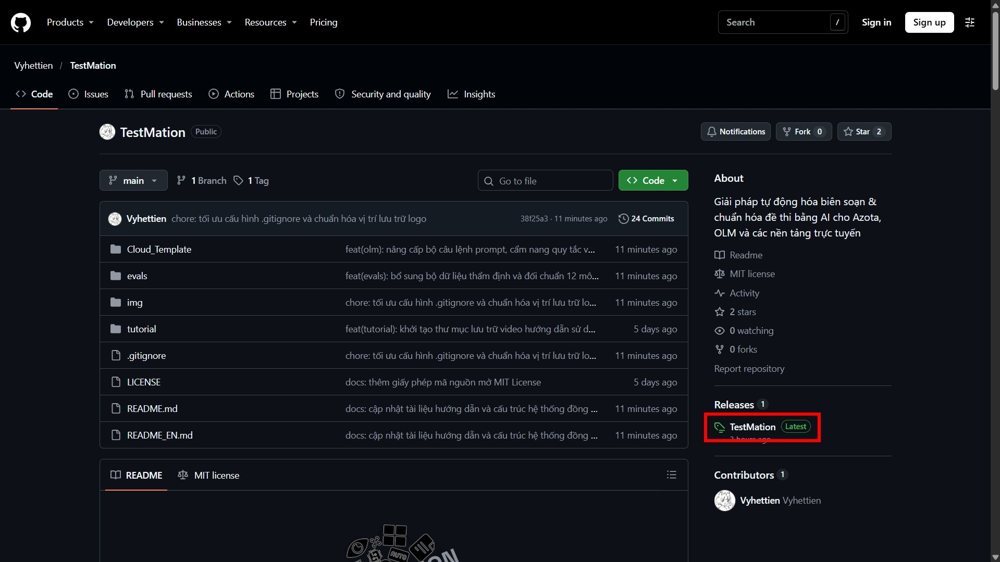

*Hình 01: Trang GitHub TestMation – mục Releases*

#### [ BƯỚC 02 ]  Tải file OLMation.md về máy

Trong danh mục **Assets**, bấm chọn **OLMation.md** để tải về máy. Đây là bộ câu lệnh tiếng Việt tối ưu cho OLM. Nếu cần phiên bản tiếng Anh, hãy chọn **OLMation_EN.md**.

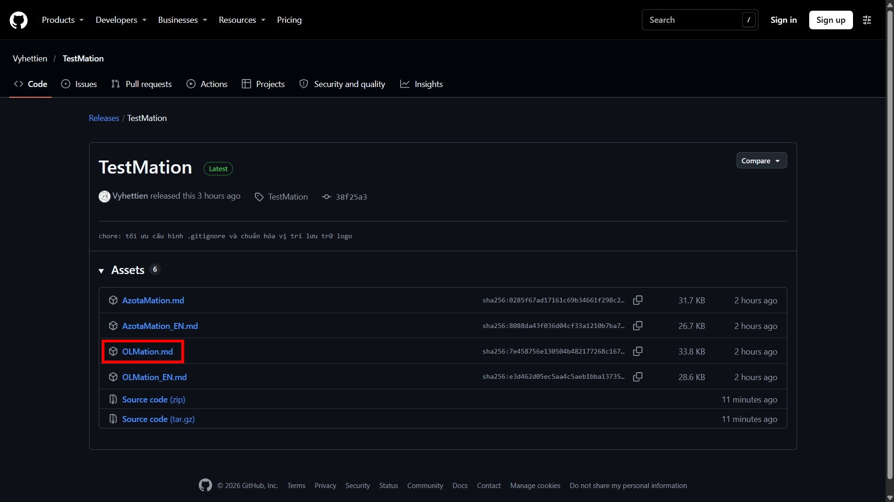

*Hình 02: Danh sách Assets – tải file OLMation.md*

## B. Nhờ AI soạn đề (gõ P1, P2, P3)

#### [ BƯỚC 03 ]  Đưa bộ câu lệnh cho AI

Mở cuộc trò chuyện mới trên AI. Bấm dấu **+** (1) để đính kèm file OLMation.md (2). Sau đó gửi câu lệnh ngắn như: “Nạp cấu hình mẫu này giúp tôi” (3). AI sẽ phản hồi xác nhận sẵn sàng tiếp nhận đề.

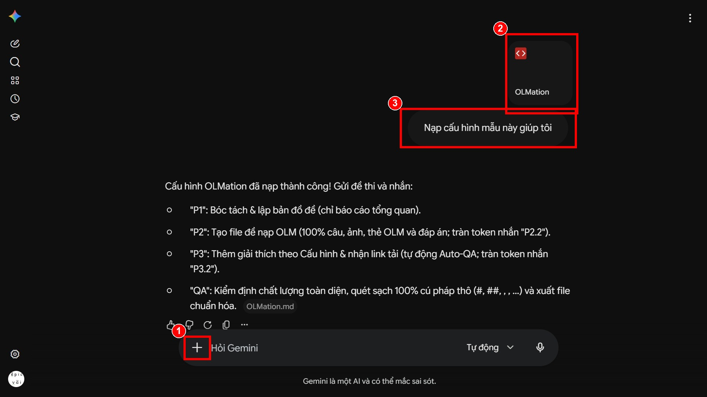

*Hình 03: Đính kèm file câu lệnh OLMation cho AI*

#### [ BƯỚC 04 ]  Gửi đề thi và gõ P1

Đính kèm file đề thi gốc (1), sau đó gõ câu lệnh **P1** và gửi (2). AI sẽ quét cấu trúc đề và báo cáo tổng quan: số lượng câu, phân chia từng phần. Hãy kiểm tra xem số câu có khớp với đề gốc.

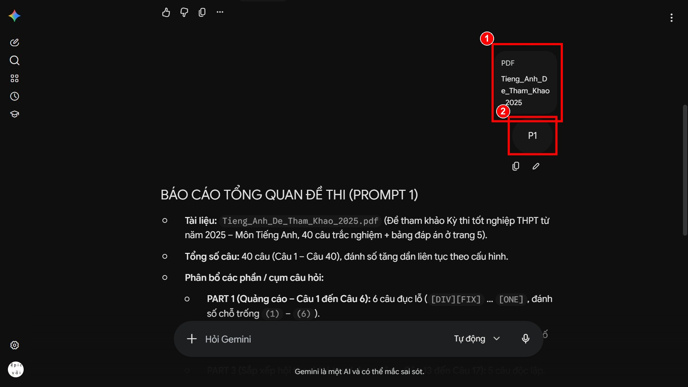

*Hình 04: Gõ P1 – Báo cáo tổng quan cấu trúc đề*

#### [ BƯỚC 05 ]  Gõ P2 để AI soạn lại đề

Gõ câu lệnh **P2** (1). AI sẽ chuyển đổi và soạn thảo lại toàn bộ câu hỏi và các phương án theo chuẩn cú pháp Word của OLM. Đáp án đúng được tự động gạch chân theo quy định.

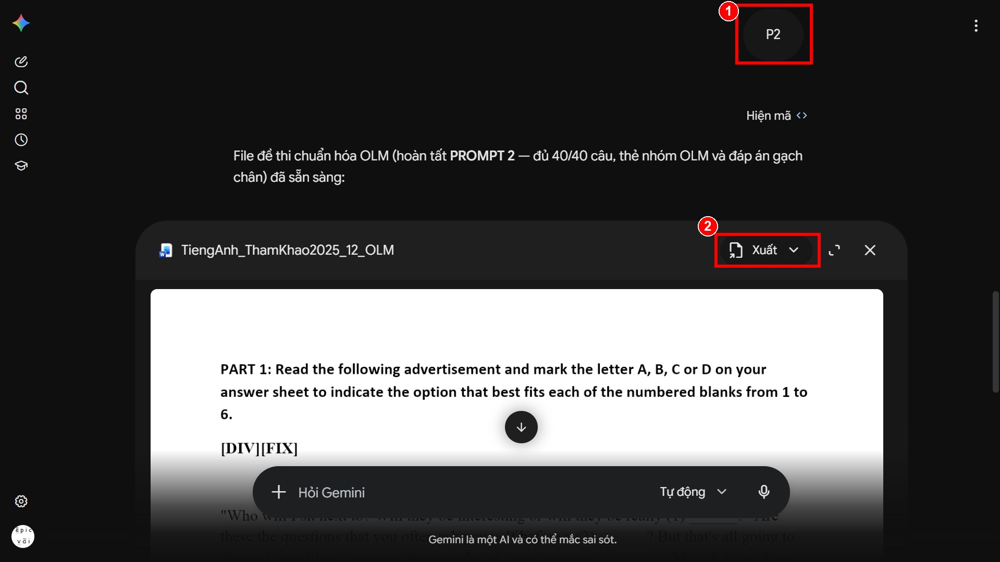

*Hình 05: Gõ P2 – Soạn thảo đề theo mẫu Word OLM*

#### [ BƯỚC 06 ]  Gõ P3 và tải file Word

Gõ lệnh **P3**. AI sẽ viết lời giải chi tiết cho từng câu hỏi. Khi hoàn tất, bấm nút **Xuất** để tải tệp Word (.docx) về máy tính. Trên AI khác, nút này có thể là một đường link tải file.

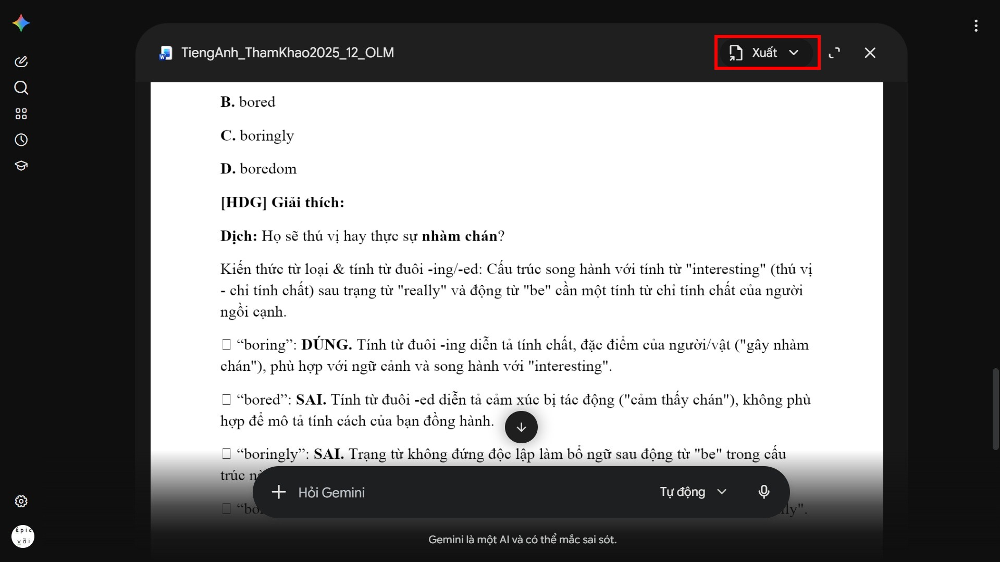

*Hình 06: Gõ P3 – Xuất và tải file Word về máy*

> **Lưu ý:** Nếu đề gốc không kèm đáp án, AI sẽ tự chọn đáp án và tự viết lời giải, nên có thể sai. Hãy tự soát lại đáp án từng câu, không chỉ soát định dạng.

> **Mẹo:** Nếu AI chỉ trả về văn bản mà không có file Word, hãy yêu cầu: “Xuất kết quả thành file .docx”. Nếu AI đó không tạo được file, hãy chuyển sang AI khác có tính năng tạo file.

#### [ BƯỚC 07 ]  Mở file Word kiểm tra (đề Tiếng Anh)

Mở file vừa tải về. Nếu Word hiển thị thanh màu vàng, bấm **Enable Editing** để bật chỉnh sửa. Ở khung Navigation bên trái, kiểm tra danh mục câu hỏi (1). Phương án đúng có gạch chân (2). Dưới mỗi câu có mục **Giải thích** chi tiết (3).

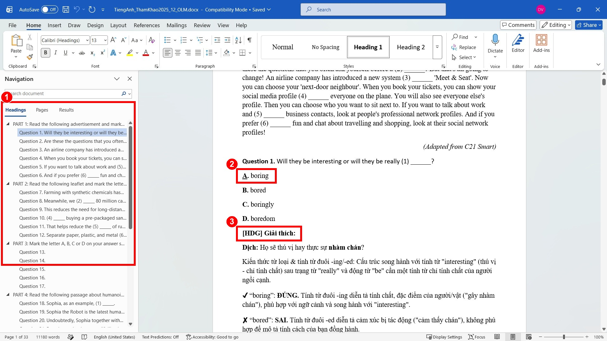

*Hình 07: Kiểm tra file Word môn Tiếng Anh*

#### [ BƯỚC 08 ]  Mở file Word kiểm tra (đề Toán)

Nếu thanh màu vàng còn hiện, bấm **Enable Editing** (1). Kiểm tra danh mục câu hỏi có đủ 3 phần (2). Câu hỏi điền khuyết có định dạng **Trả lời: [[...]]** (3). Các công thức toán học phải hiển thị rõ nét. Nếu đề có hình vẽ hoặc bảng biểu, kiểm tra xem hình có đủ và nằm đúng câu không.

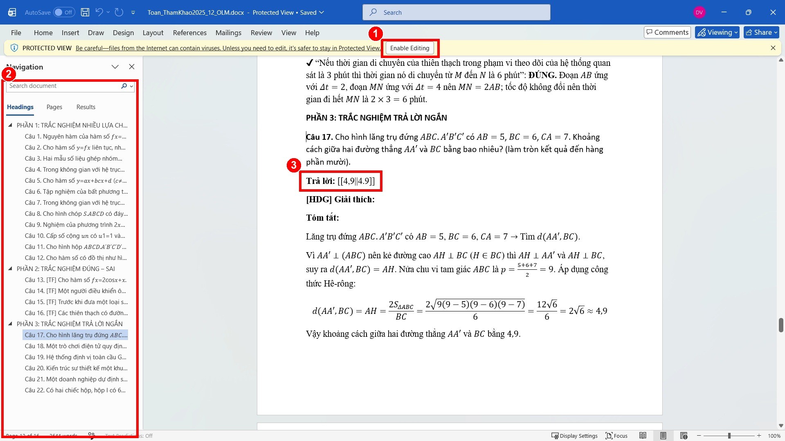

*Hình 08: Kiểm tra công thức và câu trả lời ngắn môn Toán*

> **Mẹo:** Nếu đề thi dài khiến AI dừng lại giữa chừng, bạn chỉ cần gõ các lệnh nối tiếp: **P1.2**, **P2.2** hoặc **P3.2** để AI tiếp tục sinh phần còn lại.

> **Mẹo:** Để AI rà soát kiểm tra lỗi lần cuối, hãy gõ lệnh **QA**. AI sẽ tự động dọn dẹp các ký hiệu thừa như dấu thăng (#, ##) trong tài liệu.

## C. Đưa đề lên OLM

#### [ BƯỚC 09 ]  Vào Trang giáo viên

Đăng nhập tài khoản giáo viên trên OLM, sau đó bấm vào nút **Trang giáo viên** ở góc trên màn hình.

*Hình 09: Bảng điều khiển OLM – Chọn Trang giáo viên*

#### [ BƯỚC 10 ]  Mở mục Học liệu của tôi

Tại thanh menu bên trái, bấm chọn mục **Học liệu của tôi** (1). Sau đó bấm nút màu cam **Tạo mới học liệu** (2).

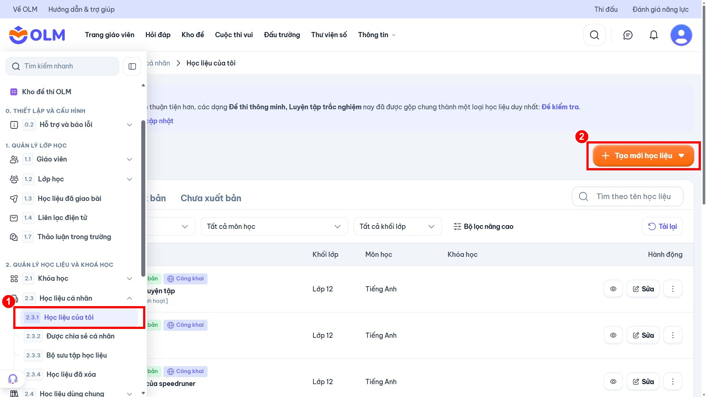

*Hình 10: Giao diện quản lý Học liệu của tôi*

#### [ BƯỚC 11 ]  Chọn loại Luyện tập, đề thi

Sau khi bấm **Tạo mới học liệu** (1), trong danh sách hiện ra, chọn mục **Luyện tập, đề thi** (2).

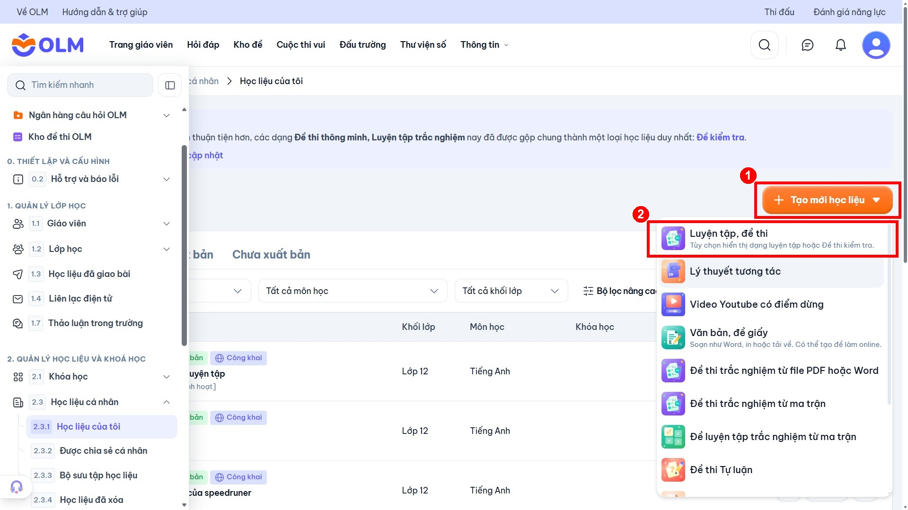

*Hình 11: Chọn phân loại Luyện tập, đề thi*

#### [ BƯỚC 12 ]  Điền thông tin và khởi tạo đề

Nhập **(1) Tên đề thi**, chọn **(2) Khối lớp** và **(3) Môn học** tương ứng. Sau đó bấm nút **(4) Tạo**.

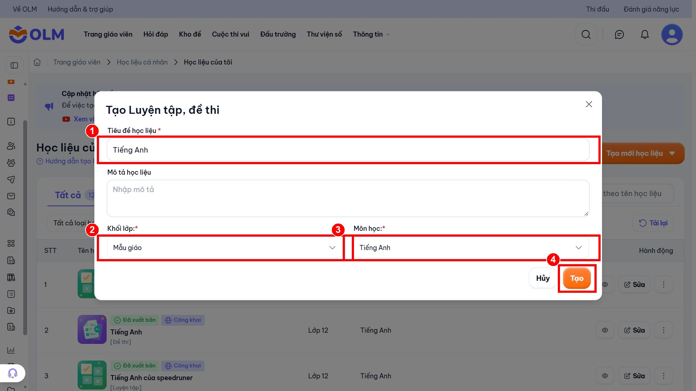

*Hình 12: Điền thông tin cơ bản của đề thi*

#### [ BƯỚC 13 ]  Bấm Import từ file

Tại màn hình soạn thảo đề của OLM, bấm vào nút chức năng **Import từ file** để bắt đầu nạp tệp Word.

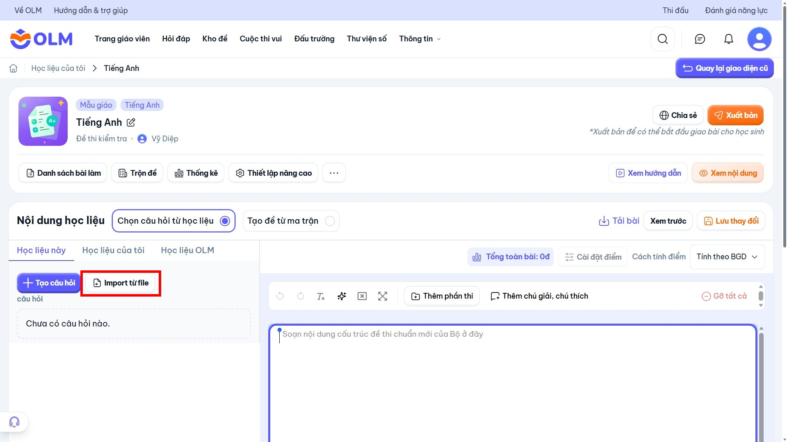

*Hình 13: Chọn chức năng Import từ file*

#### [ BƯỚC 14 ]  Chọn file Word đã soạn

Bấm nút **Chọn tệp từ máy**, sau đó chọn file Word chuẩn đã được tải về từ AI ở Phần B.

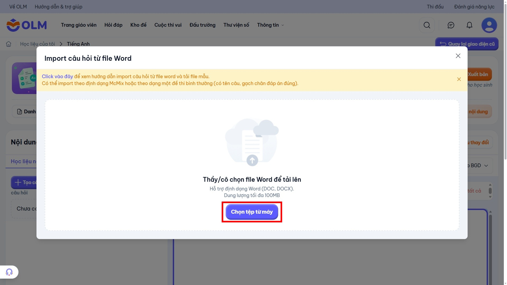

*Hình 14: Tải file Word lên hệ thống OLM*

#### [ BƯỚC 15 ]  Xem lại và lưu bộ câu hỏi

Hệ thống hiển thị danh sách các câu hỏi đã nhận diện (1). So số câu với số AI đã báo ở bước P1, rồi kiểm tra ngẫu nhiên vài câu về nội dung và đáp án gạch chân. Thấy chuẩn xác, bấm **Lưu bộ câu hỏi** (2).

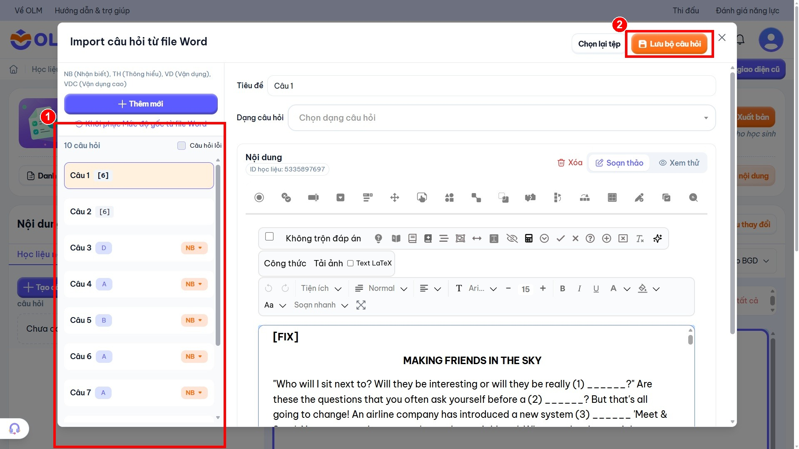

*Hình 15: Kiểm tra nhận diện câu hỏi và Lưu*

> **Mẹo:** Nếu có câu hỏi cảnh báo lỗi, tích vào ô **Câu hỏi lỗi** để lọc nhanh. Bạn có thể sửa trực tiếp trên OLM hoặc sửa trong Word rồi bấm **Chọn lại tệp**.

## D. Cài đặt chung quy tắc làm bài

> Quy tắc này áp dụng chung cho cả hai nhánh tổ chức thi. Sau khi thiết lập xong, bạn chọn tiếp Nhánh 1 hoặc Nhánh 2.

#### [ BƯỚC 16 ]  Cài đặt quy tắc làm bài nâng cao

Tại trang thông tin đề, bấm vào mục **Thiết lập nâng cao**. Tùy chỉnh các quy tắc mong muốn: cho phép học sinh làm lại (1), chấm điểm theo từng ý nhỏ (2), cho phép xem đáp án sau khi nộp (3).

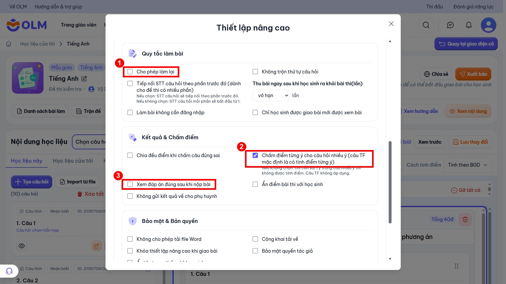

*Hình 16: Cấu hình quy tắc làm bài nâng cao*

## Nhánh 1: Chế độ Thi / Kiểm tra

> Áp dụng khi tổ chức bài kiểm tra chính thức: học sinh hoàn thành toàn bộ bài thi rồi mới nộp và biết điểm.

### Phần thiết lập giáo viên

#### [ BƯỚC 17 ]  Cấu hình thời gian làm bài kiểm tra

Trong **Thiết lập nâng cao**, chọn chế độ **Đề thi** (1). Bấm mục **Thiết lập cho đề thi** (2) và nhập thời lượng làm bài theo phút (3) (nhập 0 nếu không giới hạn giờ).

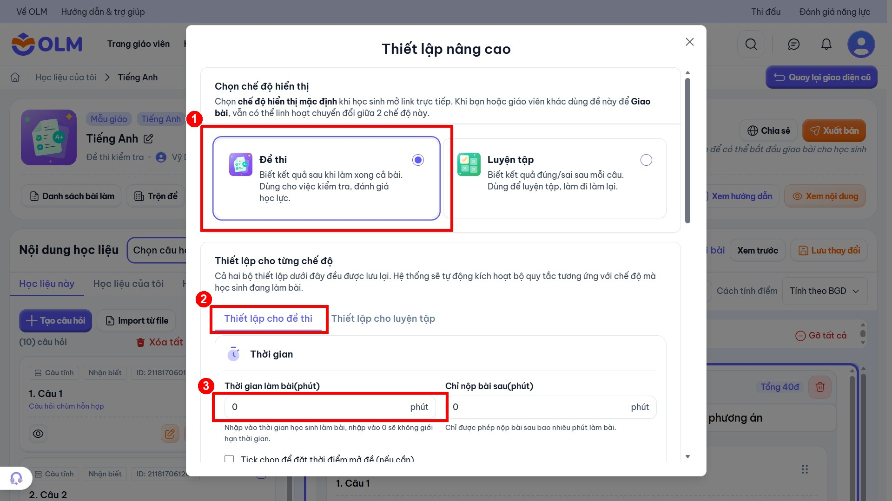

*Hình 17: Thiết lập thời gian cho bài kiểm tra*

#### [ BƯỚC 18 ]  Xuất bản chế độ Đề thi thông minh

Bấm nút **Xuất bản**, chọn chế độ **Đề thi thông minh** (1), rồi bấm xác nhận **Xuất bản** (2). Sau đó xem thử đề rồi mới giao bài ở các bước bên dưới.

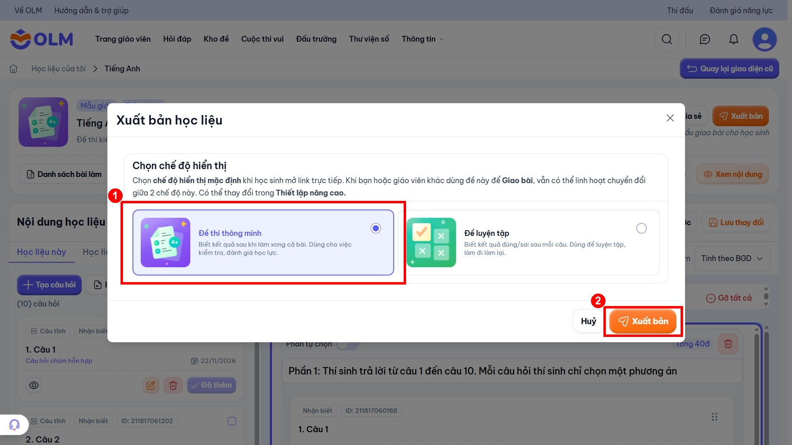

*Hình 18: Xuất bản bài thi chế độ Đề thi thông minh*

#### [ BƯỚC 19 ]  Xem thử đề trước khi giao

Bật tùy chọn **Hiển thị đáp án** (1) để rà soát toàn bộ đáp án. Hoặc bấm **Làm bài** (2) để trải nghiệm làm thử đề thi dưới góc nhìn học sinh.

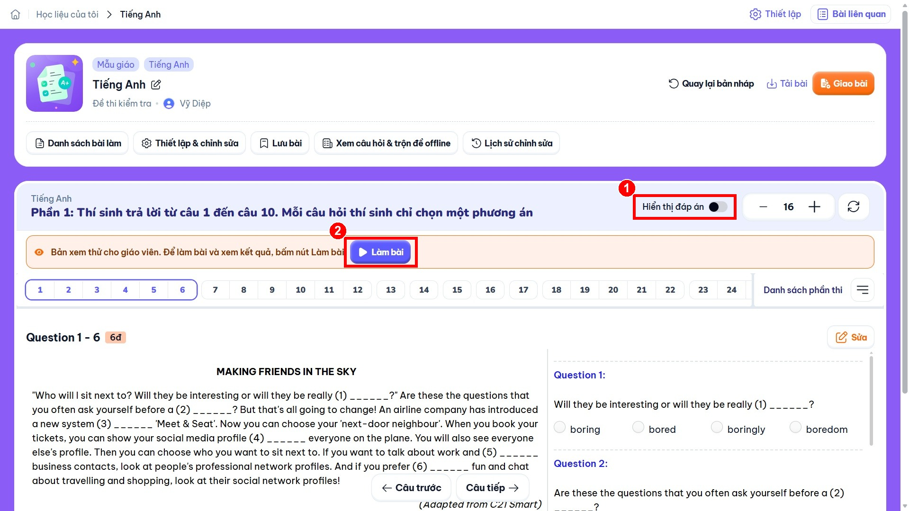

*Hình 19: Xem trước giao diện đề thi hoàn chỉnh*

> **Mẹo:** Nên bấm **Làm bài** để tự trải nghiệm thử 1 lượt trước khi gửi link chính thức cho học sinh.

#### [ BƯỚC 20 ]  Tạo link giao bài

Bấm nút **Giao bài** (1). Xem lại các tùy chọn giao theo lớp hoặc giao tự do, sau đó bấm **Tạo bài giao & lấy link** (2).

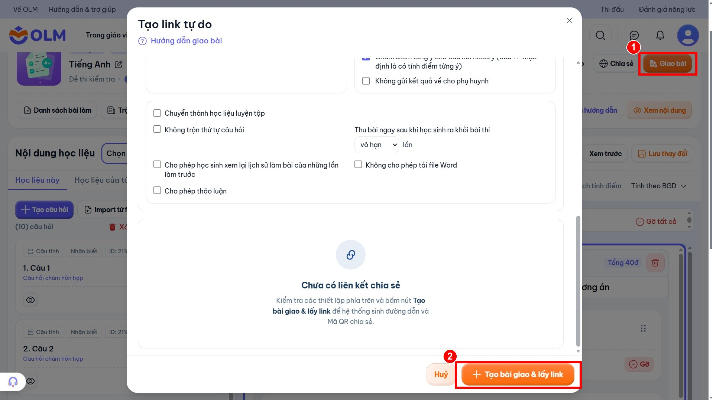

*Hình 20: Tạo link giao bài tập tự do*

#### [ BƯỚC 21 ]  Gửi link và mã QR cho học sinh

Bấm **Sao chép** (1) để copy đường link gửi vào nhóm lớp. Bạn có thể bấm **Tải mã QR** (2) để in ra giấy hoặc chiếu lên màn hình lớp học, hoặc gửi trực tiếp qua Zalo/Facebook (3).

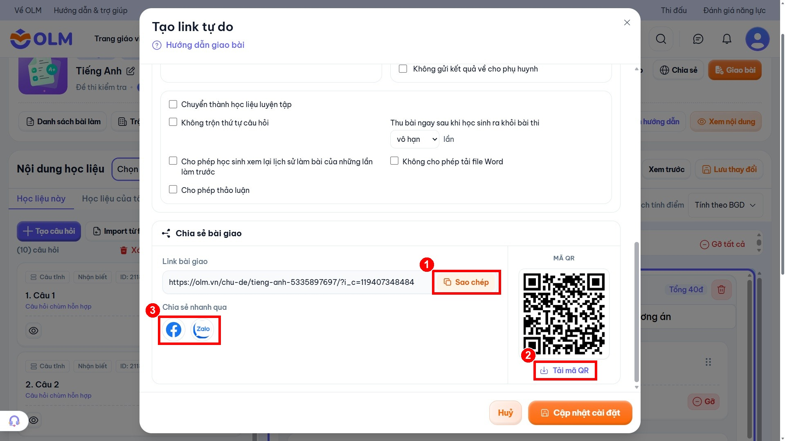

*Hình 21: Sao chép link hoặc xuất mã QR giao bài*

### Phần trải nghiệm học sinh

#### [ BƯỚC 22 ]  Học sinh bắt đầu bài thi

Học sinh mở link giáo viên gửi, xem nội quy phòng thi và bấm **Bắt đầu làm bài**. Trình duyệt sẽ tự động kích hoạt chế độ toàn màn hình.

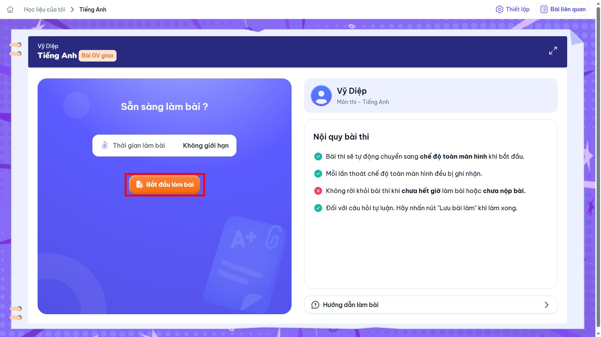

*Hình 22: Giao diện học sinh chuẩn bị vào thi*

#### [ BƯỚC 23 ]  Học sinh thao tác làm bài

Học sinh chọn phương án trả lời cho từng câu (1), bấm **Câu tiếp** (2) để chuyển câu. Khi làm xong toàn bộ, bấm **Nộp bài** (3).

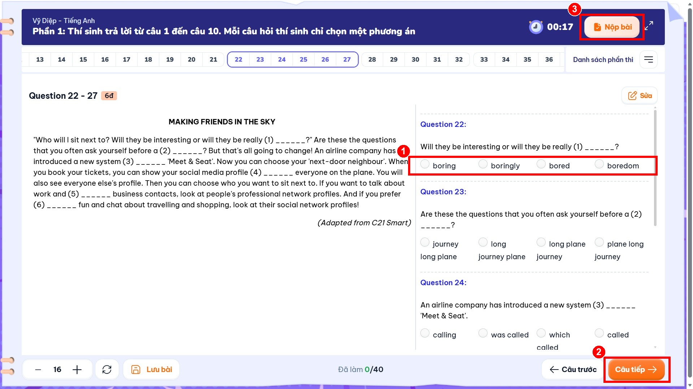

*Hình 23: Học sinh thực hiện bài kiểm tra*

#### [ BƯỚC 24 ]  Học sinh tra cứu điểm số

Ngay khi nộp bài, hệ thống hiển thị điểm số, số câu đúng/sai và tổng thời gian làm. Bấm **Xem đáp án** (1) để tra cứu bài giải, hoặc **Làm lại bài** (2) nếu được phép.

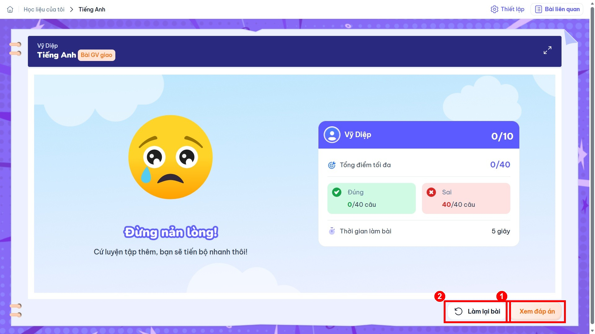

*Hình 24: Bảng điểm tổng kết sau khi nộp bài*

#### [ BƯỚC 25 ]  Học sinh xem đáp án và lời giải

Từng câu hỏi hiển thị rõ phương án đúng và mục **Explanation** (1); bấm vào để mở phần **Giải thích**, tức lời giải chi tiết từ bước P3. Bấm **Xem kết quả** (2) để quay lại bảng điểm.

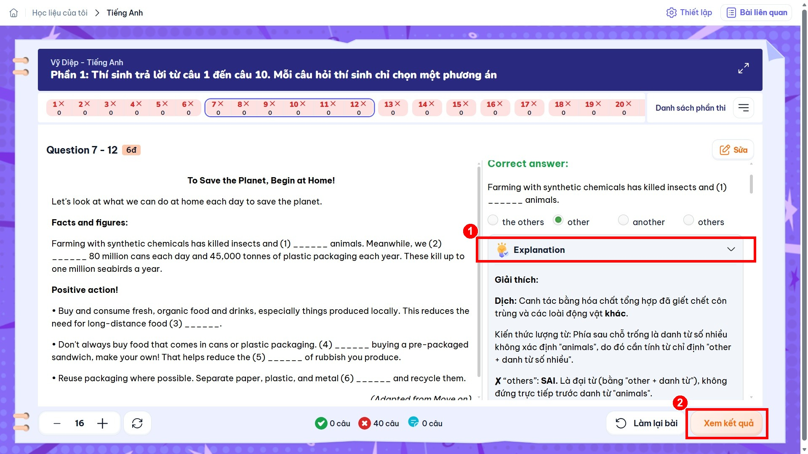

*Hình 25: Tra cứu đáp án và lời giải chi tiết*

## Nhánh 2: Chế độ Luyện tập

> Áp dụng cho bài tự học: học sinh làm từng câu, biết ngay kết quả đúng/sai kèm lời giải và được phép thử lại nhiều lần.

### Phần thiết lập giáo viên

#### [ BƯỚC 26 ]  Cấu hình chế độ luyện tập

Trong **Thiết lập nâng cao**, bấm chọn mục **Thiết lập cho luyện tập** (1). Tùy chỉnh các quyền: cho phép học sinh xem lại lịch sử các lần làm trước (2).

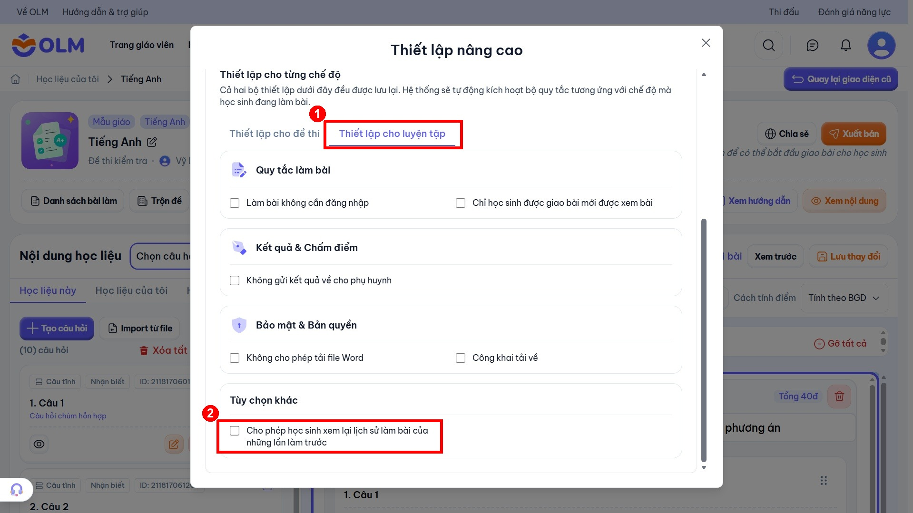

*Hình 26: Cài đặt chế độ Luyện tập linh hoạt*

#### [ BƯỚC 27 ]  Xuất bản bài luyện tập

Bấm nút **Xuất bản**, chọn chế độ **Đề luyện tập** (1), sau đó bấm **Xuất bản** (2). Sau đó xem thử rồi giao bài như Nhánh 1.

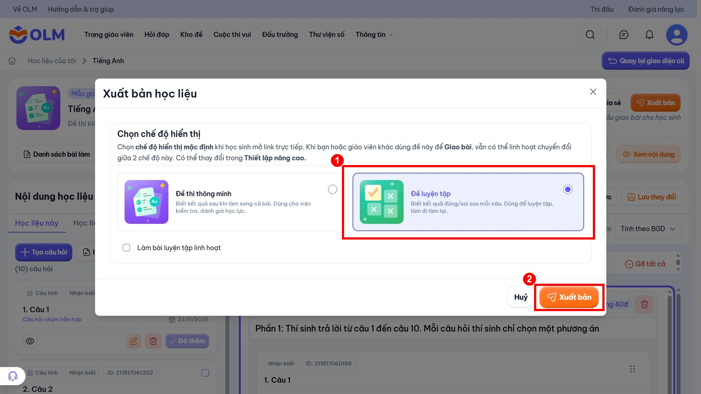

*Hình 27: Xuất bản chế độ Đề luyện tập*

#### [ BƯỚC 28 ]  Xem thử chế độ luyện tập

Giáo viên bấm vào trang đề ở chế độ luyện tập để kiểm tra giao diện gắn nhãn **Luyện tập linh hoạt**. Bấm **Làm bài** để trải nghiệm.

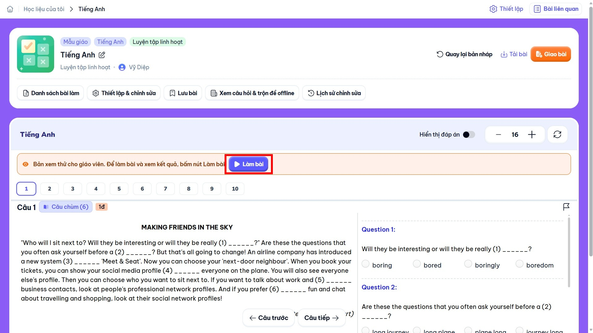

*Hình 28: Xem thử giao diện Luyện tập linh hoạt*

> **Mẹo:** Chế độ luyện tập rất phù hợp để giao bài tập về nhà hoặc ôn tập trước kỳ kiểm tra.

#### [ BƯỚC 29 ]  Tạo link và gửi cho học sinh

Bấm nút **Giao bài**, rồi bấm **Tạo bài giao & lấy link**. Sau đó bấm **Sao chép** (1) để lấy link gửi vào nhóm học tập, hoặc **Tải mã QR** (2) để chia sẻ nhanh. Thao tác giống Nhánh 1 (xem Bước 20 và Bước 21).

*Hình 29: Chia sẻ link bài luyện tập*

### Phần trải nghiệm học sinh

#### [ BƯỚC 30 ]  Học sinh bắt đầu bài luyện tập

Học sinh mở link bài tập và bấm **Bắt đầu làm bài** để vào giao diện ôn luyện.

*Hình 30: Học sinh bắt đầu bài luyện tập*

#### [ BƯỚC 31 ]  Học sinh làm bài và kiểm tra ngay

Học sinh chọn phương án (1), sau đó bấm **Kiểm tra đáp án** (2) để biết ngay kết quả câu đó. Khi muốn hoàn thành buổi học, bấm **Xác nhận nộp** (3).

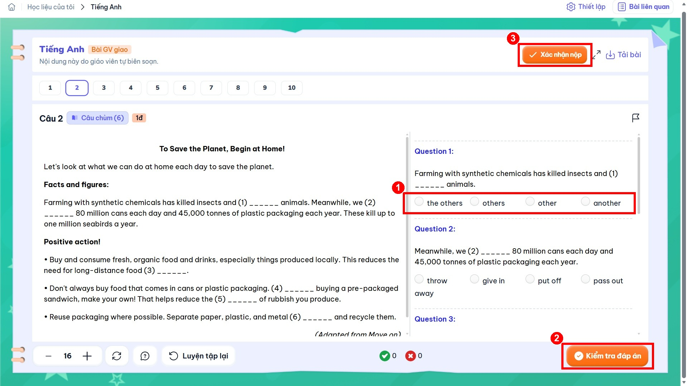

*Hình 31: Làm bài và kiểm tra kết quả ngay*

#### [ BƯỚC 32 ]  Phản hồi khi học sinh làm sai

Nếu sai, hệ thống gắn nhãn **Sai**. Học sinh có thể chọn **(1) Xem đáp án**, **(2) Làm lại câu này** để tư duy lại, hoặc **(3) Tiếp tục** sang câu sau.

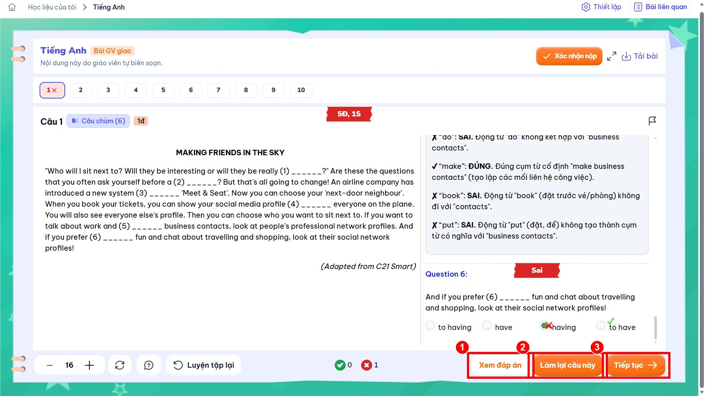

*Hình 32: Giao diện phản hồi câu trả lời sai*

#### [ BƯỚC 33 ]  Phản hồi khi học sinh làm đúng

Nếu đúng, hệ thống báo nhãn **Đúng**. Học sinh bấm mở mục **Explanation** (1) để đọc phần Giải thích, rồi bấm **Tiếp tục** (2).

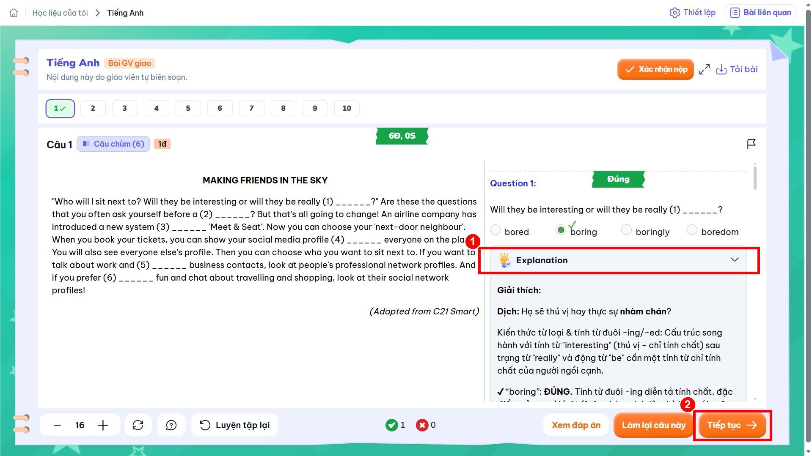

*Hình 33: Giao diện câu trả lời đúng và lời giải*

#### [ BƯỚC 34 ]  Hoàn thành phiên luyện tập

Cuối buổi luyện tập, hệ thống tổng kết số câu đúng/sai. Học sinh có thể bấm **Luyện tập lại** (1) để làm lại các câu chưa vững, hoặc **Xem đáp án** (2).

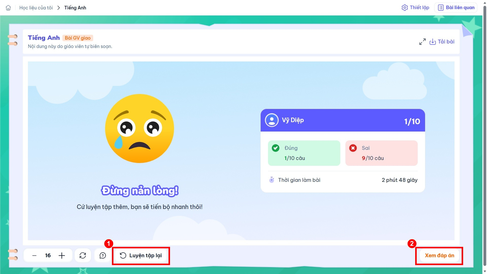

*Hình 34: Tổng kết kết quả luyện tập*

## Mấy điều cần nhớ

- Chỉ gửi file **OLMation.md** cho AI. File **OLMatic** chỉ là file mẫu để so sánh kết quả.
- Trường hợp AI bị ngắt quãng giữa chừng khi xuất đề dài, hãy gõ lệnh nối tiếp: **P1.2**, **P2.2** hoặc **P3.2**.
- Luôn mở file Word để soát đáp án, công thức và hình vẽ trước khi Import lên OLM. Đáp án và lời giải do AI viết có thể sai.
- Tự làm thử đề một lượt trước khi gửi link cho học sinh.
- Một đề thi sau khi Import lên OLM có thể sử dụng linh hoạt cho cả bài thi kiểm tra tính điểm lẫn bài luyện tập ôn bài.
